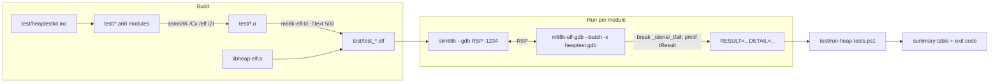

# Heap Test Suite & Harness — Architecture & Design

**Status:** All phases complete (A–8) — full functional / SOA / debug / error / stress coverage + the §9 edge-case backfill, run by a hardened one-step CI runner (`stub`/`test_kit`/`test_create`/`test_block`/`test_soa`/`test_debug`/`test_errors`/`test_stress`/`test_edges` green via `nmake test`, exit 0). The stress suite found & fixed a real SOA bug (stale slab/arena magic in released memory).
**Component:** `68kTools/libraries/heap`
**Related:** [HEAP_API.md](HEAP_API.md) · [HEAP_SMALL_ALLOC_DESIGN.md](HEAP_SMALL_ALLOC_DESIGN.md) · [heap.inc](../src/heap.inc)

**NM1 extension (2026-10-05):** `test_aligned.a68` adds checked aligned
reservations, legal prefix/suffix reuse, fragmented-bucket search, exact failure
rollback, separate descriptor cleanup, adaptive tile fallback, tile-count
clamping, and zero/debug/tail semantics. The complete suite passes 10/10.

**Repository layout:** Test sources, helpers, scripts, and generated test artifacts
live in `test/`; library sources and the public include live in `src/`. Library
object files and archives remain in the repository root.

ELF is the only supported library object format; COFF build support is retired.

---

## Table of Contents

1. [Purpose & Scope](#1-purpose--scope)
2. [Current State & Gap Analysis](#2-current-state--gap-analysis)
3. [Goals & Non-Goals](#3-goals--non-goals)
4. [Constraints & Invariants](#4-constraints--invariants)
5. [Harness Architecture](#5-harness-architecture)
6. [Test Program Structure](#6-test-program-structure)
7. [Result & Reporting Convention](#7-result--reporting-convention)
8. [Test-Support Kit (`heaptestkit.inc`)](#8-test-support-kit-heaptestkitinc)
9. [Coverage Matrix](#9-coverage-matrix)
10. [The Automated Runner](#10-the-automated-runner)
11. [Build Integration](#11-build-integration)
12. [File Layout](#12-file-layout)
13. [Phased Implementation Plan & Progress Tracker](#13-phased-implementation-plan--progress-tracker)
14. [Risks & Mitigations](#14-risks--mitigations)
15. [Open Questions](#15-open-questions)
16. [Changelog](#16-changelog)

---

## 1. Purpose & Scope

Deliver a **comprehensive, automated, self-checking test suite** for the m68k heap
library, plus a **repeatable harness** that builds, runs, and reports pass/fail
**headlessly** (CI-capable) on the sim68k simulator — with precise failure
localization and no human in the loop.

**In scope:**
- Functional coverage of all 13 public API entry points ([heap.inc](../src/heap.inc) §"Heap API
  Prototypes"): `_MachineHeapInitialize`, `_GetMachineHeap`, `_GetMachineHeaps`,
  `_HeapCreate`, `_HeapDestroy`, `_HeapAlloc`, `_HeapFree`, `_HeapReAlloc`, `_HeapSize`,
  `_HeapValidate`, `_HeapValidateHandle`, `_HeapWalk`, `_HeapCompact`.
- The Small Object Allocator (SOA) path (cells, slabs, arenas) — both **on** (default)
  and **disabled** (`HEAP_DISABLE_SMALL_POOL`).
- Every allocation/heap **flag** and every reachable **error code** (`$00`–`$17`).
- Debug/validation features: debug-fill on alloc/free, tail-guard overrun detection,
  auto-validate-on-call.
- Negative / near-miss / corruption-detection cases.
- Randomized stress/soak with invariant assertions.

**Out of scope:**
- Micro-benchmarking / cycle-accurate performance (only coarse `__HeapStats` snapshots).
- macOS **archiving/execution** on the Windows host (§14 R8).
- Concurrency (the library is single-threaded, no locking).
- Testing the assembler or the simulator themselves.

---

## 2. Current State & Gap Analysis

Two test artifacts exist today; neither is a maintainable automated **suite**.

### 2.1 `HeapTest.a68` — legacy scratch driver
- **Base-page dependent:** reads a CP/M base page off the stack at entry
  (`move.l (sp)+,a0`), so it **cannot run headless** under a bare `sim68k --gdb`
  start — SP is undefined, the read yields garbage, and the CPU bus-errors at
  `~0x520` before any heap call (a storm), identically at `SOA_ROUTE=0/1`.
- **Ad-hoc & short-circuited:** a linear sequence of `tt*` steps stitched together with
  `bra done`, so only a small fraction actually executes on any given run.
- **No automated verdict:** results are inspected by hand; there is no `tResult`, no
  failure code, no exit status.
- **Verdict:** useful as a manual CP/M-hosted scratchpad; not suitable as the suite.

### 2.2 `HeapSmallTest.a68` — the good model (SOA only)
- **Self-contained:** allocates its heap from an in-BSS `heapbuf` (`$40000`) via
  `_MachineHeapInitialize(0, heapbuf, size)` — **no base page**, runs headless.
- **Self-checking:** `tResult` (`$0000FFFF` sentinel → `0` pass → `$PPCC` fail code),
  `tDetail` for context, mirrored in `D7`/`D6`; converges on a `_tdone` self-loop.
- **Phased & precise:** per-check codes `$PPCC` (phase, check) localize any failure
  exactly.
- **Limits:** SOA-only; a single monolithic file; **hand-rolls every check**
  (`move.l #code,d7 / cmp / bne _tfail` — heavy boilerplate); and running it is a
  **manual** `sid68k` session with hardcoded addresses (`g,1780`, `DL 3948`).

### 2.3 Gaps to close
| # | Gap | Addressed by |
|---|-----|--------------|
| 1 | No automated coverage of the **block-path** public API | §6, §9, Phase 2 |
| 2 | Boilerplate-heavy authoring | Macro kit §8, Phase 1 |
| 3 | Manual run, hardcoded addresses, `sid68k` hang on piped EOF | GDB-batch runner §10, Phase 0/7 |
| 4 | No coverage map / no notion of "done" | Coverage matrix §9, Phase 8 |
| 5 | No `make test`, no CI verdict/exit code | §10–§11, Phase 7 |
| 6 | Error-code & near-miss/corruption cases scattered | §9, Phases 4–5 |

---

## 3. Goals & Non-Goals

**Goals**
- **G1 — Coverage:** every public entry point, every flag, every reachable error code,
  plus SOA on/off, debug features, and negative/near-miss cases.
- **G2 — Automated & headless:** one command builds, runs, and verdicts the whole suite
  with **no interaction**; nonzero process exit on any failure.
- **G3 — Precise localization:** a failure yields a unique code + detail that maps to an
  exact assertion.
- **G4 — Self-contained & deterministic:** no CP/M/base page; fixed heap base/size and
  fixed sequences ⇒ reproducible addresses and golden values.
- **G5 — Low-boilerplate authoring:** adding a check is a one-line macro; adding an area
  is a new module + one runner-registry line.
- **G6 — Fast:** the whole suite runs in seconds under the simulator.
- **G7 — CI-friendly:** machine-parseable summary; decoded failures; exit code.

**Non-Goals**
- Performance benchmarking beyond `__HeapStats` snapshots.
- macOS archiving or execution on the Windows host (§14 R8).
- Fuzzing the assembler/simulator; concurrency testing.

---

## 4. Constraints & Invariants

- **C1 — Headless simulator:** tests run under `sim68k --gdb` (a GDB **RSP stub** on TCP
  `1234`; the FDC worker is forced synchronous under `--gdb`, giving a deterministic
  instruction stream). No console/BDOS is assumed.
- **C2 — No exception vectors:** a bare self-contained test installs **no** exception
  vector table. Any **mid-run** trap or breakpoint vectors through the zero table → wild
  jump → CPU storm (runaway SSP). **Therefore the only safe stop is the `_tdone`/`_tfail`
  convergence point**, reached by a normal `bra`/`jmp`, never by a trap. The harness sets
  breakpoints **only** on those symbols.
- **C3 — Calling convention:** args pushed right-to-left, **caller cleans** (`adda.l
  #n,sp`); `D0/D1/A0/A1` scratch (caller-saved); `D2–D7/A2–A6` callee-saved. `D0` returns
  the handle/pointer/status. Test code that must survive a call keeps values in `D2–D7`.
- **C4 — Determinism:** fixed `heapbuf` base + size and fixed allocation order ⇒ stable
  addresses, enabling golden-value assertions. Any randomness uses a **fixed-seed** LCG.
- **C5 — Symbols:** ELF is built `/Cx` (case-sensitive labels) with `/Zi` debug info, so
  `m68k-elf-gdb` resolves `_tdone`, `_tfail`, `tResult`, `tDetail` **by name** — the
  runner carries **no hardcoded addresses**.
- **C6 — SOA default-on:** `SOA_ROUTE=1`. Small allocations route to cells unless
  `HEAP_DISABLE_SMALL_POOL` is set (per-heap or per-call). The suite must exercise **both**
  paths.
- **C7 — SOA authoring traps** (see [HEAP_SMALL_ALLOC_DESIGN.md](HEAP_SMALL_ALLOC_DESIGN.md)
  §12 and repo notes): never write into a *free* cell (its first 4 bytes are the intrusive
  free-list control word — dirtying them corrupts `slFreeHd`); and freeing the *last* cell
  of a slab releases the arena (on a debug-fill heap the released block is poisoned,
  clobbering the just-freed cell). Tests use an **anchor cell** helper to keep a slab alive.

---

## 5. Harness Architecture



The harness has four layers:

1. **Self-contained test ELFs** (§6) — one per functional area, each converging on a
   `_tdone` self-loop with a verdict in `tResult`.
2. **A test-support kit** (§8) — `heaptestkit.inc`: macros for setup, checks, and API-call
   boilerplate, plus the shared result convention.
3. **An automated runner** (§10) — `m68k-elf-gdb --batch` driven by a `heaptest.gdb`
   command file against the sim68k stub. GDB resolves symbols, breaks at `_tdone`/`_tfail`,
   prints `tResult`/`tDetail`, and **exits cleanly** (`--batch`). This is the CI path.
4. **A driver script** — `run-heap-tests.ps1` builds, iterates modules, parses the
   `RESULT=`/`DETAIL=` line, decodes it, prints a summary, and sets the process exit code.

**Why GDB-batch, not scripted `sid68k`:** `sid68k` is the right tool for **interactive**
triage (`!heap`, `!heap -p`), but with no argv + piped stdin it does **not** exit on EOF
(it hangs the pipe), and an argv-loaded ELF skips the DDT symbol table. `m68k-elf-gdb
--batch` is fully scriptable, symbol-aware from the ELF, and exits cleanly — and sim68k's
own banner endorses `m68k-elf-gdb` + `target remote localhost:1234` as a first-class
client. (`m68k-elf-gdb` confirmed present at `C:\SysGCC\m68k-elf\bin` and
`C:\git\worm68k\tools\elf`.) `sid68k` remains documented as the **debug** path (§10.3).

---

## 6. Test Program Structure

Tests are grouped into a small number of **self-contained ELF modules** (isolation +
clear attribution, without a launch per micro-test). Each module mirrors the proven
`HeapSmallTest.a68` skeleton via the kit:

```asm
        .model  flat
        include heap.inc
        include heaptestkit.inc         ; macros + result convention
        .code
start:  TEST_INIT  heapbuf,HEAPBUFSIZE  ; in-BSS heap, sentinel, clear D6/D7
        PHASE   1                       ; ... groups of checks ...
        ; EXPECT_* / HALLOC / HFREE ...
        TEST_PASS                       ; clr tResult; fall into _tdone
        TEST_EPILOGUE                   ; _tfail / _tdone / .bss (tResult,tDetail,heapbuf)
```

Proposed modules:

| Module | Area under test |
|--------|-----------------|
| `test_create.a68`  | `_MachineHeapInitialize`, `_GetMachineHeap(s)`, `_HeapCreate`, `_HeapDestroy`, `_HeapValidateHandle` |
| `test_block.a68`   | Block-path `_HeapAlloc`/`_HeapFree`/`_HeapReAlloc`/`_HeapSize`/`_HeapWalk`/`_HeapValidate`/`_HeapCompact` with the SOA **disabled** |
| `test_soa.a68`     | SOA path — folds in / supersedes `HeapSmallTest.a68` (cells, slabs, arenas, discriminator, transitions) |
| `test_debug.a68`   | Debug-fill (alloc/free), tail-guard overrun detection, auto-validate-on-call, corrupt-and-detect for each error code |
| `test_stress.a68`  | Fixed-seed randomized alloc/free/realloc soak with interleaved validation + invariant assertions |

> **Module vs. omnibus:** grouping by area (rather than one giant ELF, or one ELF per
> micro-test) balances isolation against per-launch overhead. Each module still uses the
> phase/check code scheme internally; the runner tags results with the module name.

Legacy [HeapTest.a68](../test/HeapTest.a68) is retained (or migrated) as an **optional
CP/M-hosted integration test** run under a real CP/M image, covering the base-page/BDOS
path the headless suite deliberately avoids (§15 Q6).

---

## 7. Result & Reporting Convention

Generalized from `HeapSmallTest.a68`:

| Symbol | Meaning |
|--------|---------|
| `tResult` (long) | `$0000FFFF` = sentinel (did not complete); `0` = **all pass**; else = **failing code** |
| `tDetail` (long) | context for the failure (e.g. the size `n`, an expected/actual value, or an address) |
| `D7` / `D6` | mirror `tResult`/`tDetail` live at the stop, for eyeball inspection |
| `_tfail` | `move.l d7,tResult / move.l d6,tDetail` then fall into `_tdone` |
| `_tdone` | `jmp _tdone` self-loop — the **only** breakpoint target (C2) |

**Failure code = `$PPCC`** within a module: `PP` = phase/group byte, `CC` = check byte
(back-compatible with the existing SOA codes `$0101`…`$0944`). Global identity is
`(module, code)` — the runner supplies the module name, so codes need not be rebased
across modules. `tDetail` carries the discriminating value.

> If a single **omnibus** ELF is ever preferred over modules, widen the code to
> `$MMPPCC` (`MM` = module id) so every code is globally unique. Modules + per-module
> `tResult` is the recommended default.

The runner turns this into a human line via a **decode table** kept in lockstep with the
codes (or emitted by each module as a `.legend` section — §15 Q2).

---

## 8. Test-Support Kit (`heaptestkit.inc`)

A macro layer that removes boilerplate while expanding to the **same** proven explicit
pattern. Sketch (names illustrative; final syntax per asm68K macro rules):

**Lifecycle**
- `TEST_INIT hbuf,hsz` — init the machine heap from an in-BSS buffer, set the `$0000FFFF`
  sentinel, clear `D6/D7`.
- `PHASE ph` — set the current phase byte (a reassignable `SET` symbol used to compose
  `$PPCC`).
- `TEST_PASS` — `clr.l tResult / moveq #0,d7 / bra _tdone`.
- `TEST_EPILOGUE` — emit the `_tfail`/`_tdone` **code only**. The module declares the shared
  result vars (`hMachineHeap`, `tResult`, `tDetail`) + its `heapbuf` **directly** in `.bss`
  — asm68K raises `A2005` on `.bss` `ds.l` labels emitted from a macro (a two-pass
  redefinition), so the kit cannot generate them.

**Value assertions** (each sets `D7=$PPCC`, `D6=detail`; branch to `_tfail` on failure;
compares are **unsigned**)
- `EXPECT_NONZERO code,src` / `EXPECT_ZERO code,src`
- `EXPECT_EQ code,src,imm` / `EXPECT_NE code,src,imm`
- `EXPECT_EQV code,src,val` / `EXPECT_NEV code,src,val` — compare against a **value**
  operand (memory/register), e.g. a handle vs. `hMachineHeap`.
- `EXPECT_GE/LE/LT code,src,imm`
- `EXPECT_MAGIC code,src,magic` — assert a longword magic (`'HEAP'`, `'SCB '`, `'AREN'`,
  `'SLAB'`, `'BLKH'`).
- `EXPECT_FILL code,addr,lenb,pat` — assert a longword pattern over `[addr, addr+lenb)`.

**Flag assertions** (read the CCR the preceding `H*` call left — for status-in-Z APIs)
- `EXPECT_Z code` / `EXPECT_NZ code` — place **immediately** after `HVALIDATE` /
  `HVALIDATEH` (their trailing `ADDA` does not disturb CCR).

**Error assertion**
- `EXPECT_ERR code,experr` — call `_HeapGetError`, compare to a `HEAP_ERROR_*` value.

**API-call wrappers** (push right-to-left, `jsr`, `adda.l #n,sp`, result in `D0`)
- `HALLOC hHeap,flags,bytes` · `HFREE hHeap,pMem` · `HREALLOC hHeap,flags,pMem,bytes`
- `HSIZE hHeap,pMem` · `HCREATE opts,size` · `HDESTROY hHeap`
- `HVALIDATE hHeap,pBlock` · `HVALIDATEH hHeap` · `HWALK hHeap,pEntry` · `HCOMPACT hHeap`

Operands are passed verbatim, so the caller supplies `#` for immediates
(`HALLOC hMachineHeap,#0,#16`). Macros clobber `D0/D1/D6/D7` (and `A0/A1` for the `H*`
wrappers); keep live values in `D2-D5`/`A2-A5` or `.bss`.

**Safety helpers** (encode the §4 C7 traps)
- `ANCHOR_CELL hHeap,bytes,dst` — allocate a keep-alive cell into `dst` so freeing the cell
  under test does not empty+release its slab.
- `DIRTY_BODY pMem,cellSz` — dirty only bytes `[4..cellSz)`, leaving the free-list control
  word intact (for zero-fill-on-realloc checks).

---

## 9. Coverage Matrix

The suite is "comprehensive" when every row below has at least the listed cases
implemented and passing. `→err` means "assert via `_HeapGetError`".

### 9.1 Lifecycle & handles
| Area | Cases |
|------|-------|
| `_MachineHeapInitialize` | valid handle returned; header magic `'HEAP'`; usable via alloc |
| `_GetMachineHeap` / `_GetMachineHeaps` | returns the machine handle; enumerates N heaps into a buffer |
| `_HeapCreate` | each flag combo; header magic + distinct id; too-small size → graceful fail →err |
| `_HeapDestroy` | releases; subsequent validate of the handle →err (bad magic) |
| `_HeapValidateHandle` | valid pass; corrupt magic →err; `hhSmallPool≠0` but bad SCB magic → `SLAB_CORRUPT ($15)` |

### 9.2 Allocation
| Area | Cases |
|------|-------|
| `_HeapAlloc` sizes | `0` (defined behavior); `1`; boundaries around free buckets (64/128/256/512/1K/4K/…); around `SOA_MAX` (256 vs 257); very large |
| Flags | `HEAP_ZERO_MEMORY` (whole result zeroed); no-zero (debug-fill pattern present); `HEAP_DISABLE_SMALL_POOL` forces block path for a small size |
| Failure | exhaust the heap → returns `0` + `OUT_OF_MEMORY` →err; heap unchanged |
| Alignment | block ≥ 32-byte; cell ≥ 8-byte; assert per path |
| Accounting | `_HeapSize` / `__HeapStats` reflect committed vs requested |

### 9.3 Free
| Area | Cases |
|------|-------|
| `_HeapFree` | free a valid block and a valid cell (SOA discriminator picks the path) |
| NULL | free `NULL` → no-op (no error / defined) |
| Double-free | second free →err (`DOUBLE_FREE $16` for cells; block equivalent) |
| Cross-heap | free heap-A pointer to heap-B → `HANDLE_BLOCK_MISMATCH` →err |
| Coalesce | freeing adjacent blocks coalesces (validate neighbor links); `HEAP_DISABLE_COALESCE_ON_FREE` suppresses it |

### 9.4 ReAlloc & Size
| Area | Cases |
|------|-------|
| `_HeapReAlloc` | `NULL` ptr → `INVALID_BLOCK` (this heap is **strict**, not malloc-like); size `0` → a **minimal allocation** (not a free); grow (moved/kept), shrink — covered by [`test_edges.a68`](../test/test_edges.a68) P1 |
| In-place | `HEAP_REALLOC_IN_PLACE_ONLY`: same-size/shrink succeed; a required move → `OUT_OF_MEMORY` →err, original preserved & intact |
| Zeroing | `HEAP_ZERO_MEMORY` on grow zeroes the new tail; **no** zeroing on a same-class SOA grow (S3) |
| Transitions | SOA matrix: same-class keep; cross-class cell→cell (copy+free); small→large cell→block; (block→cell only via disable toggling) |
| `_HeapSize` | block usable size; cell class size; foreign ptr → `HANDLE_BLOCK_MISMATCH` →err |

### 9.5 Validation, Walk, Compact
| Area | Cases |
|------|-------|
| `_HeapValidate` (whole) | clean heap passes; after a mixed workload still passes |
| `_HeapValidate` (corrupt) | corrupt a block header magic / free links / counts → detected →err; SOA slab-magic corruption → `SLAB_CORRUPT`; arena corruption (bad magic, mis-aligned `arBase`, **`arTileMap` popcount ≠ `arSlabUse`**) → `SOA_ARENA_CORRUPT ($17)`; repair → clean |
| `_HeapWalk` | enumerate every block; `NO_MORE_ITEMS` at end; empty heap; `NULL` cursor start; walk after frees |
| `_HeapCompact` | coalesces adjacent frees; releases empty slabs/arenas; live cells **prevent** release; idempotent second call |

### 9.6 Debug & tail-guard
| Area | Cases |
|------|-------|
| Debug-fill on alloc | non-zeroed alloc is filled with the fill pattern (`CDCDCDCD`) over the whole result |
| Debug-fill on free | freed block/cell filled `BAADF00D`; for cells the free-list control word is written **after** the poison (survives) |
| Tail-guard | alloc with `HEAP_TAIL_CHECKING_ENABLED`, write one byte past the request, then `_HeapValidate`/`_HeapFree` detects the overrun →err |
| Auto-validate-on-call | with the flag set, corrupt the heap then call any API → the call detects it →err |

### 9.7 Error-code sweep (assert every reachable code)
Trigger and assert (`_HeapGetError`) each of `$00`–`$17`, including
`OUT_OF_MEMORY`, `NO_MORE_ITEMS`, `HANDLE_BLOCK_MISMATCH`, `INVALID_FNXT_LINK ($14)`,
`SLAB_CORRUPT ($15)`, `DOUBLE_FREE ($16)`, `SOA_ARENA_CORRUPT ($17)`, the heap-end magic
codes, and invalid-handle/invalid-block-magic. Codes with no reachable trigger are noted
in the matrix as "unreachable — documented".

### 9.8 Near-miss / negative (no crash)
`__HeapSlabFromPtr` classification for interior, off-by-one, mid-cell, and foreign
pointers; a forged slab-magic chain with `slCellSz == 0` or `slClass ≥ SOA_NUM_CLASSES`
is **rejected without a ÷0 trap** (the F2 guard); `_HeapFree`/`_HeapSize`/`_HeapReAlloc` on
a pointer that belongs to no heap → error, **no crash**.

### 9.9 Stress / soak
Fixed-seed LCG driving a mix of alloc/free/realloc across sizes `1..4096` over the machine
heap and private heaps, interleaved `_HeapValidate`, run to arena creation and full
release; assert invariants (`live_cells == 0 ⇒ all slabs empty & releasable`) and compare
the committed-byte high-water mark against a recorded baseline. Include a **small private
heap** that forces the arena **adaptive shrink** (the `nTiles → 1` retry taken when a
full-size arena will not fit), and drive the empty-slab → empty-arena reclamation path to
completion.

---

## 10. The Automated Runner

### 10.1 `heaptest.gdb` (command file, symbolic — no addresses)

Run manual debugger commands from `test/`; the runner selects this directory
automatically.

```gdb
set pagination off
set confirm off
target remote :1234
load
break _tdone
continue
printf "RESULT=%08x DETAIL=%08x\n", *(unsigned int *)&tResult, *(unsigned int *)&tDetail
kill
quit
```
`m68k-elf-gdb <module>.elf -nx --batch -x heaptest.gdb` connects to the running sim,
transfers the image with **`load`** (sim68k ignores the positional `[file]` under `--gdb`;
`load` also sets `$pc` to the entry, `0x500`), breaks at **`_tdone` only** (on the fail
path `_tfail` writes `tResult`/`tDetail` and *falls through* into `_tdone`, so the value is
valid there for both the pass and fail paths), prints one parseable line, and exits (no
hang). `-nx` skips `~/.gdbinit`; the pointer cast reads the value because the ELF symbols
carry no C type. **Validated in Phase 0.**

### 10.2 `run-heap-tests.ps1` (driver)
1. **Build** the test ELFs (`nmake /f makefile-elf tests`) from the repository root,
   then run the module ELFs from `test/`.
2. For each module ELF:
   a. verify the selected RSP port is free; never stop unrelated processes;
   b. start a fresh `sim68k --gdb <port>` (the program is **not** passed on the command
      line — it is transferred by the gdb `load` in §10.1); wait for the RSP port to open;
   c. run `m68k-elf-gdb <module>.elf -nx --batch -x heaptest.gdb`, capture stdout;
   d. **watchdog:** `WaitForExit(timeout)`; on timeout kill gdb+sim → `TIMEOUT` (a storm
      fails fast instead of hanging);
   e. parse `RESULT=`/`DETAIL=`; `0` → pass, else decode `$PPCC` + detail;
   f. tear down only the simulator/GDB PIDs started by this runner.
3. Print a **summary table** (module · result · code · detail · decoded meaning) and set
   the process **exit code** = number of failing modules.

### 10.3 Interactive debug path (`sid68k`, secondary)
For triage, not CI: from `test/`, run `sim68k --gdb`; then `sid68k` (no argv); at `-` type
`e<module>.elf` (loads image **and** DDT symbols + sets PC), `x`, `g,_tdone`, then inspect
with `DL tResult`, `!heap`, and `!heap -p`. (Do **not** breakpoint mid-run — C2.)
Use the standalone sid68k checkout for NM1-aware descriptor/padding views;
the old sid68k tree under worm68k is obsolete.

### 10.4 Running the suite (quick start)

Run these commands from the repository root. The standalone runner also works
from another directory when invoked with an absolute script path.
The NMake `test` target uses PowerShell 7 (`pwsh`), matching the standalone examples.

- **`nmake /f makefile-elf test`** — canonical one-step: build the module ELFs, run every
  module, print the summary, and exit `0` iff all pass. This is the CI entry point.
- `nmake /f makefile-elf tests` — build the module ELFs only.
- `pwsh -File test\run-heap-tests.ps1` — build + run the default modules.
- `pwsh -File test\run-heap-tests.ps1 -NoBuild -Modules test_stress` — run one module, no rebuild.
- `pwsh -File test\run-heap-tests.ps1 -Port 4321 -TimeoutSec 40` — override the RSP port / watchdog.
- `pwsh -File test\run-heap-tests.ps1 -NoBuild -Modules test_aligned` — focused aligned regression.
- `-Sim <path> -Gdb <path>` select qualified tools; `-ReportPath <path>` records
  source/tool/archive/ELF hashes and preserves GDB logs.
  Relative report paths resolve from `test/`.

The legacy harness build targets are `test\heaptest.elf` and
`test\heapsmalltest.elf` (for example, `nmake /f makefile-elf test\heapsmalltest.elf`).

**Reading the summary.** A `PASS` row is `RESULT=00000000`. A `FAIL` row's `Note` decodes
`RESULT=$0000PPCC` as `phase P, check 0xCC`, and `DETAIL` is the failing value / error code —
look that phase+check up in `<module>.a68`. Other statuses: `TIMEOUT` (watchdog tripped —
storm/hang), `NOSIM` (RSP port never opened), `NORESULT` (gdb emitted no `RESULT=` line, with a
hint), `NOBUILD` (ELF missing). The process **exit code = number of non-passing modules**.

**Prereqs** (the runner checks all three and aborts with exit `255` if any is missing):
`sim68k.exe` (…`builds\win64\bin\Release`), `m68k-elf-gdb.exe` (`C:\SysGCC\m68k-elf\bin`), and
`heaptest.gdb` beside the runner. Teardown is wrapped in `try/finally` and targets
only owned process IDs, including watchdog failure. A temporary GDB script
uses the selected port; an occupied port is an error, not permission to kill
the process using it. The default per-module watchdog remains 20 seconds.

---

## 11. Build Integration

- Add a **`tests`** target to [makefile-elf](../makefile-elf) building the module ELFs
  (`test\test_create.elf`, `test\test_block.elf`, `test\test_soa.elf`, `test\test_debug.elf`,
  `test\test_stress.elf`), each linked like the existing `test\heapsmalltest.elf`
  (`$(LD) -T $(LDSCRIPT) -Ttext 500 test\<obj>.o -L $(LIBDIR) -lheap-elf -o $@`).
- Add a **`test`** (a.k.a. `check`) target that builds `tests` then invokes
  `test\run-heap-tests.ps1`, propagating its exit code so CI fails on any red.
- `test\heaptestkit.inc` sits beside the test modules; the public include is
  `src\heap.inc`. Test assembly rules search both the `src/` and `test/` include
  directories, and each module `include`s both files.
- Mirror the targets into `makefile.macos` for ELF source parity, carrying the known
  caveat that the macOS toolchain is not host-buildable on Windows (§14 R8).
- Keep artifacts git-ignored (`*.elf`, `*.o`, `*.lst`, `*.68k`).

---

## 12. File Layout

```
heap68k/
├─ docs/
│  └─ HEAP_TEST_SUITE_DESIGN.md ; this document
├─ src/
│  ├─ heap.inc                 ; library types + API prototypes
│  ├─ HeapAlloc.a68            ; allocation implementation
│  └─ ...                      ; remaining library assembly sources
├─ makefile-elf                ; library + test build/run targets
└─ test/
   ├─ heaptestkit.inc          ; macros + result convention (§8)
   ├─ heaptest.gdb             ; GDB batch command file (§10.1)
   ├─ run-heap-tests.ps1       ; runner / verdict / exit code (§10.2)
   ├─ stub.a68                 ; Phase 0 bootstrap smoke test
   ├─ test_kit.a68             ; test-support macro smoke test
   ├─ test_create.a68          ; lifecycle & handles
   ├─ test_block.a68           ; block-path API (SOA disabled)
   ├─ test_soa.a68             ; SOA path (supersedes HeapSmallTest.a68)
   ├─ test_debug.a68           ; debug-fill, tail-guard, auto-validate
   ├─ test_errors.a68          ; error codes + near-miss cases
   ├─ test_stress.a68          ; randomized soak
   ├─ test_edges.a68           ; edge-case coverage
   ├─ test_aligned.a68         ; aligned reservations + rollback
   ├─ HeapCompactTest.a68      ; optional CP/M-hosted compact smoke test
   ├─ HeapSmallTest.a68        ; legacy standalone SOA test
   └─ HeapTest.a68             ; optional CP/M-hosted integration test
```

---

## 13. Phased Implementation Plan & Progress Tracker

**Status legend:** ⬜ Not started · 🟨 In progress · ✅ Done · ⛔ Blocked

| Phase | Title | Status | Exit criteria |
|------:|-------|:------:|---------------|
| A | Analysis & this spec | ✅ | Spec reviewed & accepted |
| 0 | Harness bootstrap | ✅ | `heaptest.gdb` + `run-heap-tests.ps1` drive `stub.elf` end-to-end via `m68k-elf-gdb --batch`; green→exit 0, red→exit 1, watchdog→`TIMEOUT` all proven; `nmake test` green (2026-07-21) |
| 1 | Kit & result convention | ✅ | [`heaptestkit.inc`](../test/heaptestkit.inc) (all macros) + [`test_kit.a68`](../test/test_kit.a68) exercising every macro; builds `/Cx` and passes via `nmake test` (2026-07-21) |
| 2 | Block-path functional suite | ✅ | [`test_create.a68`](../test/test_create.a68) (§9.1) + [`test_block.a68`](../test/test_block.a68) (§9.2–§9.5, SOA disabled) pass via `nmake test` (2026-07-21) |
| 3 | SOA suite integration | ✅ | [`test_soa.a68`](../test/test_soa.a68) refactored onto the kit from `HeapSmallTest.a68` (9 phases); passes headless via `nmake test` (2026-07-21) |
| 4 | Debug & validation suite | ✅ | [`test_debug.a68`](../test/test_debug.a68) covers §9.6 (debug-fill alloc/free, tail-guard, auto-validate) + corrupt-and-detect (block magic, chain fwd-link, free-chain back-link, SOA slab/arena magic); passes via `nmake test` (2026-07-21) |
| 5 | Error-code & near-miss coverage | ✅ | [`test_errors.a68`](../test/test_errors.a68) triggers & asserts every code `$00`–`$17` (§9.7) + §9.8 near-miss classification, F2 ÷0 guard, and foreign-pointer API safety (no crash); passes via `nmake test` (2026-07-21) |
| 6 | Stress / soak | ✅ | [`test_stress.a68`](../test/test_stress.a68) (§9.9) fixed-seed xorshift mix (alloc/free/realloc, 1..4096, machine SOA + private block heaps) + interleaved validate + drain invariants + arena adaptive-shrink + high-water baseline; deterministic. **Found & fixed a real SOA bug** (released slab/arena kept its magic → reused memory mis-ID'd as a cell). Passes via `nmake test` (2026-07-21) |
| 7 | Runner polish & CI | ✅ | one-step `nmake test` (build+run+verdict, exit 0/n); generic `$PPCC`→"phase P, check 0xCC" decode; `try/finally` teardown + port-free wait; §10.4 quick-start added. (2026-07-21) |
| 8 | Coverage audit & backfill | ✅ | [`test_edges.a68`](../test/test_edges.a68) closes the §9 gaps — realloc NULL/0 + zero-on-grow, compact reclamation effect, walk block count, destroy-with-live-allocs, `_GetMachineHeaps` contents + truncation; §9.4 corrected. Passes via `nmake test` (2026-07-21) |

### Phase 0 — Harness bootstrap  ✅ (2026-07-21)
- [x] [`heaptest.gdb`](../test/heaptest.gdb) (§10.1): `m68k-elf-gdb -nx --batch` connects to
      `sim68k --gdb`, `load`s the image (positional `[file]` is ignored under `--gdb`;
      `load` sets `$pc` to entry `0x500`), breaks at `_tdone`, reads `tResult`/`tDetail`
      via a pointer cast (ELF symbols carry no C type), and exits cleanly. Validated
      against `heapsmalltest.elf` and `stub.elf`.
- [x] [`stub.a68`](../test/stub.a68) — minimal self-contained test (init machine heap; assert the
      handle is non-NULL and the header magic is `'HEAP'`). Proven: `RESULT=00000000` →
      runner exit `0` (green); a transient forced-fail variant → `RESULT=$000009EE`
      surfaced with exit `1` (red).
- [x] Storm **watchdog** + stale-sim/port cleanup in
      [`run-heap-tests.ps1`](../test/run-heap-tests.ps1): a transient never-reaches-`_tdone`
      variant → `TIMEOUT` at the cutoff, gdb+sim torn down, exit `1`. Fresh sim per
      module; socket-readiness wait on the RSP port.
- [x] Exit-code mechanism decided: **PowerShell parses `RESULT=`** — this `m68k-elf-gdb`
      build has **no Python** (its `.gdbinit` Python hook errors), so a gdb-python hook is
      not viable (§15 Q2).
- [x] [makefile-elf](../makefile-elf) `tests`/`test` targets build `stub.elf` and run the
      runner; `nmake /f makefile-elf test` is green under Windows PowerShell 5.1.

### Phase 1 — Kit & result convention  ✅ (2026-07-21)
- [x] [`heaptestkit.inc`](../test/heaptestkit.inc): `TEST_INIT` / `PHASE` / `TEST_PASS` /
      `TEST_EPILOGUE` (code-only; the module declares the shared `.bss` — a macro-emitted
      `ds.l` trips asm68K `A2005`).  Uses `LOCAL` / `&param&` / `SET` per the asm68K reference.
- [x] Value assertions `EXPECT_ZERO/NONZERO/EQ/NE/LT/LE/GE/MAGIC/FILL`; **flag** assertions
      `EXPECT_Z`/`EXPECT_NZ` (added for the status-in-Z `_HeapValidate*` APIs); `EXPECT_ERR`.
- [x] API wrappers `HALLOC/HFREE/HREALLOC/HSIZE/HCREATE/HDESTROY/HVALIDATE/HVALIDATEH/HWALK/HCOMPACT`.
- [x] Safety helpers `ANCHOR_CELL`, `DIRTY_BODY` (encode the §4 C7 traps).
- [x] [`test_kit.a68`](../test/test_kit.a68) smoke test expands **every** macro across 6 phases;
      assembles `/Cx` and passes (`tResult=0`) via `nmake test` (alongside `stub`). Fixed a
      latent runner bug — `$sim`/`$Sim` (and `$gdb`/`$Gdb`) collided under PowerShell's
      case-insensitive variables, breaking the 2nd module; renamed to `$simProc`/`$gdbProc`.

### Phase 2 — Block-path functional suite  ✅ (2026-07-21)
- [x] [`test_create.a68`](../test/test_create.a68): §9.1 — machine-heap init + `'HEAP'` magic +
      usable-via-alloc; `_GetMachineHeap`/`_GetMachineHeaps` (active count 1→3→2 as heaps are
      created/destroyed); `_HeapCreate` magic + distinct ids; `_HeapValidateHandle`
      valid/corrupt/repaired; `_HeapDestroy` zeroes the header so the handle no longer validates.
- [x] [`test_block.a68`](../test/test_block.a68) on private heaps created with `HEAP_DISABLE_SMALL_POOL`
      (every request takes the block path): §9.2 size / 32-byte alignment / `'BLKH'` magic /
      zero-fill / OOM; §9.3 reuse, double-free → `INVALID_BLOCK`, cross-heap →
      `HANDLE_BLOCK_MISMATCH`, NULL-free no-op, **coalesce vs. `HEAP_DISABLE_COALESCE_ON_FREE`**
      (a big alloc fits only when the freed neighbours coalesce); §9.4 realloc grow/shrink +
      `IN_PLACE_ONLY` (in-place shrink keeps the pointer; a move-requiring grow is refused,
      original intact) + `_HeapSize`; §9.5 `_HeapValidate` clean + corrupt-block-magic detect +
      repair, `_HeapWalk` to `NO_MORE_ITEMS`, `_HeapCompact`.
- [x] Both build in the `tests` target and pass via `nmake test` (4/4 green). Added kit value
      compares `EXPECT_EQV`/`EXPECT_NEV`.  Trap: a symbol named `pC` is parsed as the `PC`
      register (register names are case-insensitive even under `/Cx`) — renamed to `pQ`.

### Phase 3 — SOA suite integration  ✅ (2026-07-21)
- [x] [`test_soa.a68`](../test/test_soa.a68) — refactored `HeapSmallTest.a68` onto the kit: the init /
      pass / epilogue boilerplate is now `TEST_INIT` / `TEST_PASS` / `TEST_EPILOGUE`, and it
      `include`s `heaptestkit.inc`.  All 9 phases of SOA checks (size→class, SCB/arena/slab
      primitives, `__HeapSlabFromPtr` recognition + near-miss, alloc/free/realloc, double-free,
      debug-fill-on-free, Full↔Partial + empty-slab release, validate/compact/walk) and the
      **anchor-cell discipline** are preserved verbatim — they test SOA internals the kit does
      not wrap.
- [x] Runs headless via `m68k-elf-gdb --batch` as a runner module (`RESULT=00000000`); the
      manual `sid68k` procedure is retired for CI and kept in §10.3 for debugging.  The
      standalone `HeapSmallTest.a68`/`heapsmalltest.elf` is retained (unchanged) as a reference.

### Phase 4 — Debug & validation suite  ✅ (2026-07-21)
- [x] [`test_debug.a68`](../test/test_debug.a68): debug-fill on alloc (`CDCDCDCD`, whole cell / requested
      block bytes) and on free (`BAADF00D`, control-word-after-poison for cells — `heapDF` uses
      `HEAP_DISABLE_COALESCE_ON_FREE` so the free path always reaches the fill); tail-guard
      overrun detection (`HEAP_TAIL_CHECKING_ENABLED` → `TAIL_VALIDATION_FAILED`, then repair);
      auto-validate-on-call (`HEAP_VALIDATE_ALL_ENABLED` refuses a call while the heap is corrupt).
- [x] Corrupt-and-detect via `_HeapValidate`: block header magic → `INVALID_BLOCK`, chain
      forward link → `INVALID_NEXT_LINK`, free-chain back link → `INVALID_FPREV_LINK`, SOA slab
      magic → `SLAB_CORRUPT`, arena magic → `SOA_ARENA_CORRUPT`; each repaired → revalidates clean.
      Trap learned: `_HeapValidate` runs `_HeapValidateHandle` first, which checks `hhHeapHead`
      (→ `HEADER_BLOCK_HEADPTR_BAD $0F`) and bucket-head magics (→ `HEADER_BLOCK_FREEPTR_BAD $10`)
      — so a magic test must corrupt a **mid-chain** block (not the first) to surface
      `INVALID_BLOCK` from the chain walk.

### Phase 5 — Error-code & near-miss coverage  ✅ (2026-07-21)
- [x] [`test_errors.a68`](../test/test_errors.a68) triggers + asserts (via `_HeapGetError`) **every** code
      `$00`–`$17` (§9.7): API misuse (`SUCCESS`, `INVALID_PARAM`, `INVALID_HANDLE`, `OUT_OF_MEMORY`,
      `HANDLE_BLOCK_MISMATCH`, `INVALID_BLOCK`, `NO_MORE_ITEMS`, `NOT_INITIALIZED`, `INITIALIZED`,
      `TAIL_VALIDATION_FAILED`); `_HeapValidate` chain/free-chain/heap-end corruptions
      (`INVALID_PREV_LINK`, `INVALID_NEXT_LINK`, `HEAPEND_BAD_MAGIC`, `INVALID_HEAPEND`,
      `INVALID_FPREV_LINK`, `BLOCK_NOT_FREE`, single-block `INVALID_FNXT_LINK`); `_HeapValidateHandle`
      header corruptions (`HEADER_BAD_MAGIC`, `HEADER_INVALID_SIZE`, `HEADER_BLOCK_HEADPTR_BAD`,
      `HEADER_BLOCK_FREEPTR_BAD`); and SOA (`DOUBLE_FREE`, `SLAB_CORRUPT`, `SOA_ARENA_CORRUPT`).
      Each corruption is repaired and re-validated clean.  All `$00`–`$17` are reachable — none
      documented as unreachable.
- [x] §9.8 near-miss: `__HeapSlabFromPtr` rejects off-by-one, mid-cell, and foreign pointers
      (recognizes the real cell as a positive control); the **F2 ÷0 guard** rejects a real magic
      chain with `slCellSz == 0` and with `slClass >= SOA_NUM_CLASSES` **without trapping**; and
      `_HeapFree`/`_HeapSize` on a foreign pointer return `INVALID_BLOCK` with no crash.
      Trap re-confirmed: a symbol named `pC` binds to the `PC` register even under `/Cx` → renamed `pCc`.

### Phase 6 — Stress / soak  ✅ (2026-07-21)
- [x] [`test_stress.a68`](../test/test_stress.a68): a fixed-seed xorshift-32 PRNG drives a deterministic
      alloc/free/realloc mix (sizes 1..4096) over the SOA machine heap (slots 0..31) and a private
      block heap (slots 32..63), with a per-block tag catching cross-block corruption and
      `_HeapValidate` interleaved every 256 iterations.  After a full drain it asserts the
      reclamation invariant (`scbLiveCells == 0` **and** `scbSlabCount == scbArenaCount == 0`),
      a clean compact, and heapP coalescing back to one large block; a 12 KB heap then exercises
      the arena **adaptive shrink** (4 → 1 tiles) and empty-arena reclamation; finally the
      live-byte / live-count high-water marks are checked against recorded baselines.
- [x] Deterministic: the exact high-water baselines are asserted every run, so an identical
      `RESULT` (and the same peak) is reproduced across repeated runs (verified back-to-back).
- [x] **Bug found & fixed** (the point of the soak): `__HeapSlabRelease`/`__HeapArenaRelease`
      freed a tile/arena **without invalidating its `slMagic`/`arMagic`**, so once that memory was
      reused by the block path a pointer that masked to the stale tile base was mis-recognized as a
      cell by `__HeapSlabFromPtr` and routed to `__HeapSoaFree` — driving `scbLiveCells` negative
      (−6) and mis-reporting `_HeapSize`.  Fix: clear `slMagic` on tile release and `arMagic` on
      arena release.  Slab/arena reclamation counts were already correct; only the magic-based
      recognition was fooled.

### Phase 7 — Runner polish & CI  ✅ (2026-07-21)
- [x] One-step `nmake /f makefile-elf test` (the `test` target depends on `tests`, so make
      builds the ELFs then runs the driver `-NoBuild`); prints the summary table and propagates
      the driver's **exit code = number of non-passing modules** (0 = all green) for CI.
- [x] **Decoded** summary: any non-zero `RESULT` is decoded generically as `phase P, check 0xCC`
      (`Get-ResultNote`), with `$0000FFFF` as the "never reached `_tdone`" sentinel and an optional
      per-module override table; no more "unknown code".  Robust teardown (`try/finally` always
      kills the sim), a **port-free wait** before each module (never attach to a dying sim on a
      stale port), and a `NORESULT` hint from the gdb output.  Quick-start documented in §10.4.
- [ ] Not done (deferred): mirroring the `tests`/`test` targets into `makefile.macos`
      (the macOS toolchain is not host-buildable on Windows — §14 R8).

### Phase 8 — Coverage audit & backfill  ✅ (2026-07-21)
- [x] Walked the §9 matrix against every module; every row now has an implemented, passing case.
      [`test_edges.a68`](../test/test_edges.a68) closes the thin spots the functional/stress suites left:
      `_HeapReAlloc` corner cases (NULL ptr → `INVALID_BLOCK`, size 0 → minimal alloc,
      `HEAP_ZERO_MEMORY` zeroes the grown tail); `_HeapCompact`'s reclamation **effect** (a
      `DISABLE_COALESCE_ON_FREE` heap is fragmented, a big alloc fails, compact merges the
      adjacent frees and the alloc then fits + its return grows); `_HeapWalk` block enumeration
      **count** (5 allocations counted; empty heap → 0 + `NO_MORE_ITEMS`); `_HeapDestroy` of a heap
      that still holds live allocations (discards them, reclaims the region, count returns to
      baseline); and `_GetMachineHeaps` buffer **contents** (buf[1..] are valid distinct handles)
      plus `N < count` **truncation** (returns the true count, writes only N, no overrun).
- [x] Corrected design §9.4: this library's `_HeapReAlloc` is strict — a NULL pointer is
      `INVALID_BLOCK` and size 0 yields a minimal allocation (the earlier C-style wording was
      aspirational and did not match the implementation).  Residual out-of-scope: `HEAP_TRAP_ON_ERROR`
      (halts the CPU, not harness-testable) and Phase 7 runner/CI polish.

---

## 14. Risks & Mitigations

| # | Risk | Impact | Mitigation |
|---|------|--------|-----------|
| R1 | Bare test installs no vectors; a mid-run trap/BP storms the CPU | crash / hang | Break **only** at `_tdone` (reached by `bra`, never a trap — C2; `_tfail` falls through into it); watchdog timeout; fresh sim per module |
| R2 | Scripted `sid68k` hangs (no EOF exit; argv-load drops symbols) | CI hang | Use `m68k-elf-gdb --batch` (clean exit, ELF symbols) as the runner; `sid68k` is interactive-only (§10.3) |
| R3 | Hardcoded addresses drift as tests change | brittle suite | Resolve `_tdone`/`tResult`/… **by symbol** in GDB (C5); zero addresses in the runner |
| R4 | TCP `1234` contention / stale `sim68k` | flaky runs | Kill stale sim + free the port before each module; optional per-run port (§15 Q5) |
| R5 | Non-determinism (RNG/timing) breaks golden checks | flaky | Fixed-seed LCG (C4); sim FDC forced sync under `--gdb`; fixed heap base/size |
| R6 | Debug-fill vs `ZERO_MEMORY` precedence surprises (the `$CDCDCDCD` SCB-init class of bug) | false failures / crashes | Encode the precedence in tests; explicit-zero where required; cover both flag orders |
| R7 | SOA authoring traps (dirtying a free cell; last-cell free releases the arena under debug-fill) | self-inflicted crash | `ANCHOR_CELL`/`DIRTY_BODY` helpers (§8); documented in the kit (C7) |
| R8 | macOS toolchain can't archive/run on the Windows host | host-specific builds | Windows ELF is the reference/CI platform; macOS ELF builds require a macOS host |
| R9 | Coverage rot as the library evolves | silent gaps | Keep the §9 matrix in lockstep; `nmake test` in CI; Phase 8 audit |
| R10 | Legacy `HeapTest.a68` base-page dependency | can't run headless | New suite is self-contained; legacy driver retained only as an optional CP/M-hosted integration test |

---

## 15. Open Questions

- **Q1 — Module granularity:** a few area-grouped ELFs (recommended) vs. one omnibus ELF
  vs. one ELF per micro-test. Grouped modules balance isolation and launch overhead; the
  omnibus needs `$MMPPCC` global codes (§7).
- **Q2 — Exit-code mechanism:** **Resolved (Phase 0): PowerShell parses `RESULT=`.** The
  installed `m68k-elf-gdb` has **no Python**, so the gdb-python `SystemExit(1)` hook is not
  available. Open sub-item: emit a `.legend` decode table from each module (Phase 7).
- **Q3 — Console semihosting:** does sim68k expose a putchar/console device in its device
  window (`@0x0FF000`) that a bare ELF could write, letting tests print a human-readable
  `PASS`/`FAIL <code>` to the sim's stdout and drop the GDB memory-read step entirely?
  (Investigate sim68k device docs — would further simplify CI.)
- **Q4 — Golden values vs. invariants:** how much to assert exact addresses/sizes (tight,
  but brittle across library changes) vs. structural invariants (robust). Recommend
  invariants + relative checks by default; reserve exact goldens for unit-level checks.
- **Q5 — Parallelism:** `sim68k --gdb [port]` **does** accept a configurable RSP port
  (confirmed in Phase 0 via [sim.cpp](../../../sim68k/sim.cpp)), so modules can run in parallel
  on distinct ports; the runner currently serializes on one port (its `-Port` parameter).
- **Q6 — Legacy integration test:** migrate `HeapTest.a68` to run under a real CP/M image
  on sim68k (covering the base-page/BDOS path), or retire it once `test_block` supersedes
  its intent?

---

## 16. Changelog

| Date | Change |
|------|--------|
| 2026-07-21 | Initial architecture & design: harness (GDB-batch runner + `heaptestkit.inc`), coverage matrix, phased plan & progress tracker. `m68k-elf-gdb` availability confirmed; sim68k `--gdb` RSP stub endorsed by its own banner. |
| 2026-07-21 | **Phase 0 complete** — `heaptest.gdb`, [`stub.a68`](../test/stub.a68), [`run-heap-tests.ps1`](../test/run-heap-tests.ps1), and makefile `tests`/`test` targets. Validated green (exit 0), red (exit 1, code surfaced), and watchdog (`TIMEOUT`) end-to-end; `nmake test` green. Confirmed the gdb `load` model (positional file ignored under `--gdb`), the no-Python gdb (⇒ PowerShell exit-code parse), and the `_tdone`-only breakpoint. |
| 2026-07-21 | **Phase 1 complete** — [`heaptestkit.inc`](../test/heaptestkit.inc) macro kit (`TEST_*`, `EXPECT_*` incl. flag-based `EXPECT_Z/NZ`, `H*` wrappers, `ANCHOR_CELL`/`DIRTY_BODY`) via asm68K `LOCAL`/`&param&`/`SET`, plus [`test_kit.a68`](../test/test_kit.a68) exercising every macro (6 phases; passes via `nmake test`). Learned: macro-emitted `.bss ds.l` trips `A2005` (modules declare shared vars directly). Fixed the runner's case-insensitive `$sim`/`$Sim` variable collision that broke multi-module runs (→ `$simProc`/`$gdbProc`). |
| 2026-07-21 | **Phase 2 complete** — [`test_create.a68`](../test/test_create.a68) (§9.1 lifecycle/handles) + [`test_block.a68`](../test/test_block.a68) (§9.2–§9.5 block path via `HEAP_DISABLE_SMALL_POOL`: sizes/alignment/zero/OOM, double-free/cross-heap/NULL, coalesce vs. no-coalesce, realloc + in-place, validate/walk/compact). Added `EXPECT_EQV`/`EXPECT_NEV` value compares; 4/4 green via `nmake test`. Trap noted: a symbol named `pC` binds to the `PC` register (register names are case-insensitive even under `/Cx`) → renamed `pQ`. |
| 2026-07-21 | **Phase 3 complete** — [`test_soa.a68`](../test/test_soa.a68): refactored `HeapSmallTest.a68` onto the kit (`TEST_INIT`/`TEST_PASS`/`TEST_EPILOGUE` + `include heaptestkit.inc`); all 9 phases of SOA checks + the anchor-cell discipline preserved verbatim. Runs headless via the runner (`RESULT=00000000`); 5/5 green via `nmake test`. Retires the manual `sid68k` procedure for CI (kept in §10.3 for debugging). |
| 2026-07-21 | **Phase 4 complete** — [`test_debug.a68`](../test/test_debug.a68) (§9.6): debug-fill on alloc (`CDCDCDCD`) and free (`BAADF00D`, control-word-after-poison for cells; `HEAP_DISABLE_COALESCE_ON_FREE` so the free fill is always reached), tail-guard overrun → `TAIL_VALIDATION_FAILED`, auto-validate-on-call refuses a call on a corrupt heap, and corrupt-and-detect (block magic→`INVALID_BLOCK`, fwd link→`INVALID_NEXT_LINK`, free back-link→`INVALID_FPREV_LINK`, slab→`SLAB_CORRUPT`, arena→`SOA_ARENA_CORRUPT`) with repair-revalidate. 6/6 green via `nmake test`. Trap learned: `_HeapValidate` runs `_HeapValidateHandle` first (checks `hhHeapHead`→`$0F` and bucket heads→`$10`), so a magic corruption must target a **mid-chain** block to surface `INVALID_BLOCK`. |
| 2026-07-21 | **Phase 5 complete** — [`test_errors.a68`](../test/test_errors.a68) (§9.7/§9.8): triggers & asserts every heap error code `$00`–`$17` (all reachable — none unreachable) across API misuse, whole/single-block `_HeapValidate` corruptions, `_HeapValidateHandle` header corruptions, and SOA double-free/slab/arena, each repaired and re-validated; plus near-miss `__HeapSlabFromPtr` classification (off-by-one / mid-cell / foreign), the F2 ÷0 guard (`slCellSz == 0`, `slClass >= SOA_NUM_CLASSES`), and foreign-pointer `_HeapFree`/`_HeapSize` → `INVALID_BLOCK` with no crash. 7/7 green via `nmake test`. Re-hit the `pC`→`PC` register-name trap (renamed `pCc`). |
| 2026-07-21 | **Phase 6 complete** — [`test_stress.a68`](../test/test_stress.a68) (§9.9): fixed-seed xorshift-32 soak (alloc/free/realloc 1..4096 over the SOA machine heap + a private block heap), interleaved validate, tagged data-integrity, drain reclamation invariants (`scbLiveCells`/`scbSlabCount`/`scbArenaCount == 0`), arena adaptive-shrink (4→1) + empty-arena reclamation, and a deterministic live-byte/count high-water baseline (identical across runs). 8/8 green via `nmake test`. **Found & fixed a real SOA defect:** `__HeapSlabRelease`/`__HeapArenaRelease` left `slMagic`/`arMagic` intact on freed memory, so reused blocks were mis-recognized as cells by `__HeapSlabFromPtr` (drove `scbLiveCells` to −6, mis-reported `_HeapSize`); fix clears both magics on release. Reclamation counts themselves were already correct. |
| 2026-07-21 | **Phase 8 complete** — [`test_edges.a68`](../test/test_edges.a68): coverage-audit backfill of the §9 edge cases the functional/stress suites left thin — `_HeapReAlloc` NULL→`INVALID_BLOCK` / size-0→minimal-alloc / `ZERO_MEMORY`-zeroes-grown-tail, `_HeapCompact` reclamation **effect** on a no-coalesce heap (fragment→merge→fit + return grows), `_HeapWalk` block enumeration **count** (5 + empty), `_HeapDestroy` with **live allocations** inside, and `_GetMachineHeaps` buffer **contents** + `N < count` **truncation** (no overrun). Corrected the design §9.4 realloc wording to match the strict implementation. 9/9 green via `nmake test`. Only Phase 7 (runner polish/CI/README) remains. |
| 2026-07-21 | **Phase 7 complete** — runner hardening in [`run-heap-tests.ps1`](../test/run-heap-tests.ps1): one-step `nmake test` (build+run+verdict, exit = #failures) confirmed; generic `$PPCC`→"phase P, check 0xCC" decode (`Get-ResultNote`) replacing the sparse lookup; `try/finally` teardown that always tears the sim down; a per-module **port-free wait** so gdb never attaches to a dying sim on a stale port; and a `NORESULT` hint. Added the §10.4 quick-start. Full suite still 9/9 green (exit 0). **All test-suite phases (A–8) are now complete.** |
