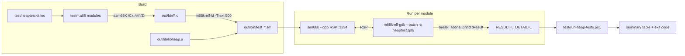

# Heap Test Suite & Harness — Architecture & Design

**Status:** Ten automated modules implemented, including `test_aligned`;
source/coverage audit 2026-11-09. The original phases A–8 are complete, but this
is a regression suite, not exhaustive coverage of every flag/input combination
(see §9.11). The earlier stress suite found the released slab/arena magic bug.
**Component:** `heap68k`
**Related:** [HEAP_API.md](HEAP_API.md) · [HEAP_SMALL_ALLOC_DESIGN.md](HEAP_SMALL_ALLOC_DESIGN.md) · [heap.inc](../src/heap.inc)

**NM1 extension (2026-10-05):** `test_aligned.a68` adds checked aligned
reservations, legal prefix/suffix reuse, fragmented-bucket search, exact failure
rollback, separate descriptor cleanup, adaptive tile fallback, tile-count
clamping, and zero/debug/tail semantics. The complete suite passes 10/10.

**Repository layout:** Test sources, helpers, and scripts live in `test/`; library
sources and the public include live in `src/`. All generated artifacts live under
the Git-ignored `out/` directory: test objects/listings/executables in `out/bin/`,
the public include in `out/include/`, and library objects/listings/archive in `out/lib/`.

ELF is the only supported library object format; COFF build support is retired.

---

## Table of Contents

1. [Purpose & Scope](#1-purpose--scope)
2. [Current State & Gap Analysis](#2-current-state--gap-analysis)
3. [Goals & Non-Goals](#3-goals--non-goals)
4. [Constraints & Invariants](#4-constraints--invariants)
5. [Harness Architecture](#5-harness-architecture)
6. [Test Program Structure](#6-test-program-structure)
7. [Result & Reporting Convention](#7-result--reporting-convention)
8. [Test-Support Kit (`heaptestkit.inc`)](#8-test-support-kit-heaptestkitinc)
9. [Coverage Matrix](#9-coverage-matrix)
10. [The Automated Runner](#10-the-automated-runner)
11. [Build Integration](#11-build-integration)
12. [File Layout](#12-file-layout)
13. [Phased Implementation Plan & Progress Tracker](#13-phased-implementation-plan--progress-tracker)
14. [Risks & Mitigations](#14-risks--mitigations)
15. [Open Questions](#15-open-questions)
16. [Changelog](#16-changelog)

---

## 1. Purpose & Scope

Deliver a **comprehensive, automated, self-checking test suite** for the m68k heap
library, plus a **repeatable harness** that builds, runs, and reports pass/fail
**headlessly** (CI-capable) on the sim68k simulator — with precise failure
localization and no human in the loop.

**In scope:**
- Functional coverage of 14 public entry points: the 13 PROTO declarations in
  [heap.inc](../src/heap.inc) plus the `_HeapGetError` leaf:
  Prototypes"): `_MachineHeapInitialize`, `_GetMachineHeap`, `_GetMachineHeaps`,
  `_HeapCreate`, `_HeapDestroy`, `_HeapAlloc`, `_HeapFree`, `_HeapReAlloc`, `_HeapSize`,
  `_HeapValidate`, `_HeapValidateHandle`, `_HeapWalk`, `_HeapCompact`, `_HeapGetError`.
- The Small Object Allocator (SOA) path (cells, slabs, arenas) — both **on** (default)
  and **disabled** (`HEAP_DISABLE_SMALL_POOL`).
- Representative implemented allocation/heap flags and explicit assertions
  for every current error code (`$00`–`$17`). Remaining flag gaps are in §9.11;
  tagging and trap-on-error are reserved, unimplemented options.
- Debug/validation features: debug-fill on alloc/free, tail-guard overrun detection,
  auto-validate-on-call.
- Negative / near-miss / corruption-detection cases.
- Randomized stress/soak with invariant assertions.

**Out of scope:**
- Micro-benchmarking / cycle-accurate performance (only coarse `__HeapStats` snapshots).
- macOS **archiving/execution** on the Windows host (§14 R8).
- Concurrency (the library is single-threaded, no locking).
- Testing the assembler or the simulator themselves.

---

## 2. Current State & Gap Analysis

The current automated suite is the ten modules in §6, built by the Windows
makefile and run by the PowerShell driver. The following legacy-driver
assessment and original gaps explain its starting point; they are not a
claim that automation is still missing.

### 2.1 `HeapTest.a68` — legacy scratch driver
- **Base-page dependent:** reads a CP/M base page off the stack at entry
  (`move.l (sp)+,a0`), so it **cannot run headless** under a bare `sim68k --gdb`
  start — the required loader-provided base-page pointer is absent, so the
  driver fails before a heap call.
- **Ad-hoc & short-circuited:** a linear sequence of `tt*` steps stitched together with
  `bra done`, so only a small fraction actually executes on any given run.
- **No automated verdict:** results are inspected by hand; there is no `tResult`, no
  failure code, no exit status.
- **Verdict:** useful as a manual CP/M-hosted scratchpad; not suitable as the suite.

### 2.2 `HeapSmallTest.a68` — the good model (SOA only)
- **Self-contained:** initializes an in-BSS heap with capacity
  `HEAPBUFSIZE-128` — **no base page**, runs headless.
- **Self-checking:** `tResult` (`$0000FFFF` sentinel → `0` pass → `$PPCC` fail code),
  `tDetail` for context, mirrored in `D7`/`D6`; converges on a `_tdone` self-loop.
- **Phased & precise:** per-check codes `$PPCC` (phase, check) localize any failure
  exactly.
- **Legacy structure:** SOA-only, monolithic, and hand-written assertions
  (`move.l #code,d7 / cmp / bne _tfail`) rather than the kit's value macros.
- **Current use:** the checks are preserved in `test_soa`. The legacy ELF
  also works with the symbolic runner after `nmake` builds it:
  `pwsh -File test\run-heap-tests.ps1 -NoBuild -Modules heapsmalltest`.
  The original hardcoded-address sid68k procedure is not a current run command.

### 2.3 Original gaps addressed by the suite
| # | Gap | Addressed by |
|---|-----|--------------|
| 1 | No automated coverage of the **block-path** public API | §6, §9, Phase 2 |
| 2 | Boilerplate-heavy authoring | Macro kit §8, Phase 1 |
| 3 | Manual run, hardcoded addresses, `sid68k` hang on piped EOF | GDB-batch runner §10, Phase 0/7 |
| 4 | No coverage map / no notion of "done" | Coverage matrix §9, Phase 8 |
| 5 | No `make test`, no CI verdict/exit code | §10–§11, Phase 7 |
| 6 | Error-code & near-miss/corruption cases scattered | §9, Phases 4–5 |

---

## 3. Goals & Non-Goals

**Goals**
- **G1 — Coverage:** public entry points and current error codes, plus
  representative SOA on/off, flag, debug, and controlled negative cases.
  Expand the focused regressions listed in §9.11 rather than claiming exhaustion.
- **G2 — Automated & headless:** one command builds, runs, and verdicts the whole suite
  with **no interaction**; nonzero process exit on any failure.
- **G3 — Precise localization:** a failure yields a unique code + detail that maps to an
  exact assertion.
- **G4 — Self-contained & deterministic:** no CP/M/base page; fixed heap base/size and
  fixed sequences ⇒ reproducible addresses and golden values.
- **G5 — Low-boilerplate authoring:** most checks use one-line macros.
  A new default module also needs makefile ELF/object dependencies and link
  rules, the runner's default module list, and a coverage-matrix update.
- **G6 — Fast:** the whole suite runs in seconds under the simulator.
- **G7 — CI-friendly:** machine-parseable summary; decoded failures; exit code.

**Non-Goals**
- Performance benchmarking beyond `__HeapStats` snapshots.
- macOS archiving or execution on the Windows host (§14 R8).
- Fuzzing the assembler/simulator; concurrency testing.

---

## 4. Constraints & Invariants

- **C1 — Headless simulator:** tests run through the bundled simulator's GDB
  RSP stub, default TCP port `1234`. No console/BDOS is assumed.
- **C2 — No exception vectors:** a bare self-contained test installs **no** exception
  vector table. Any **mid-run** trap or breakpoint vectors through the zero table → wild
  jump → CPU storm (runaway SSP). **Therefore the only safe stop is the `_tdone`/`_tfail`
  convergence point**, reached by a normal `bra`/`jmp`, never by a test-issued
  trap. The command file sets **only `break _tdone`**; `_tfail` records the
  failure and falls through there.
- **C3 — Calling convention:** args pushed right-to-left, **caller cleans** (`adda.l
  #n,sp`); `D0/D1/A0/A1` scratch (caller-saved); `D2–D7/A2–A6` callee-saved. `D0` returns
  the handle/pointer/status for most APIs. `_HeapValidate` and
  `_HeapValidateHandle` preserve D0 and report through CCR.Z. Test values must
  also avoid D6/D7, which the assertion macros reserve.
- **C4 — Determinism:** fixed `heapbuf` base + size and fixed allocation order ⇒ stable
  addresses within a particular build. Prefer structural/relative assertions
  across code changes. Stress randomness uses fixed-seed **xorshift-32**, not an LCG.
- **C5 — Symbols:** ELF is built `/Cx` (case-sensitive labels) with `/Zi` debug info, so
  `m68k-elf-gdb` resolves `_tdone`, `_tfail`, `tResult`, `tDetail` **by name** — the
  runner carries **no hardcoded addresses**.
- **C6 — SOA default-on:** `SOA_ROUTE=1`. Small allocations route to cells unless
  `HEAP_DISABLE_SMALL_POOL` is set (per-heap or per-call). The suite must exercise **both**
  paths.
- **C7 — SOA authoring traps** (see [HEAP_SMALL_ALLOC_DESIGN.md](HEAP_SMALL_ALLOC_DESIGN.md)
  §12): never overwrite a free cell's first four bytes (its intrusive
  free-list control word). White-box fill tests that intentionally dirty a
  free-cell body preserve that word; production callers must not touch freed memory.
  Freeing the *last* cell
  of a slab releases that slab and, if its arena has no other live tiles, the
  arena (on a debug-fill heap the released backing is poisoned,
  clobbering the just-freed cell). Tests use an **anchor cell** helper to keep a slab alive.

---

## 5. Harness Architecture



The harness has four layers:

1. **Self-contained test ELFs** (§6) — one per functional area, each converging on a
   `_tdone` self-loop with a verdict in `tResult`.
2. **A test-support kit** (§8) — `heaptestkit.inc`: macros for setup, checks, and API-call
   boilerplate, plus the shared result convention.
3. **An automated runner** (§10) — `m68k-elf-gdb --batch` driven by a `heaptest.gdb`
   command file against the sim68k stub. GDB resolves symbols, breaks at `_tdone`,
   prints `tResult`/`tDetail`, and **exits cleanly** (`--batch`). This is the CI path.
4. **A driver script** — `run-heap-tests.ps1` builds, iterates modules, parses the
   `RESULT=`/`DETAIL=` line, decodes it, prints a summary, and sets the process exit code.

**Why GDB-batch:** it resolves ELF symbols, transfers the image with `load`,
prints machine-parseable results, and exits without interaction. Historical
sid68k scripting had EOF/symbol-loading limitations; that external debugger
is neither bundled nor required. The runner defaults to
`toolchain\windows\m68k-elf-gdb.exe`; optional interactive debugging is in §10.3.

---

## 6. Test Program Structure

Tests are grouped into a small number of **self-contained ELF modules** (isolation +
clear attribution, without a launch per micro-test). Each module mirrors the proven
`HeapSmallTest.a68` result protocol. Most use the kit; `stub` hand-writes its
bootstrap, and `test_soa` retains the legacy manual assertions with kit lifecycle:

```asm
        .model  flat
        include heap.inc
        include heaptestkit.inc         ; macros + result convention
        .code
HEAPBUFSIZE equ $40000
start:  TEST_INIT  heapbuf,HEAPBUFSIZE-128 ; usable capacity excludes metadata
        PHASE   1                       ; ... groups of checks ...
        ; EXPECT_* / HALLOC / HFREE ...
        TEST_PASS                       ; clr tResult; fall into _tdone
        TEST_EPILOGUE                   ; _tfail / _tdone code only
        .bss
hMachineHeap ds.l 1
tResult      ds.l 1
tDetail      ds.l 1
heapbuf      ds.b HEAPBUFSIZE+BLK_HDR_SIZE ; allow start-alignment loss too
        end
```

Current default modules:

| Module | Area under test |
|--------|-----------------|
| `stub.a68` | Minimal machine-heap/bootstrap check of the runner protocol. |
| `test_kit.a68` | Core lifecycle, assertions, API wrappers, and safety helpers. |
| `test_create.a68`  | `_MachineHeapInitialize`, `_GetMachineHeap(s)`, `_HeapCreate`, `_HeapDestroy`, `_HeapValidateHandle` |
| `test_block.a68`   | Block-path `_HeapAlloc`/`_HeapFree`/`_HeapReAlloc`/`_HeapSize`/`_HeapWalk`/`_HeapValidate`/`_HeapCompact` with the SOA **disabled** |
| `test_soa.a68`     | SOA path — folds in / supersedes `HeapSmallTest.a68` (cells, slabs, arenas, discriminator, transitions) |
| `test_debug.a68`   | Debug fill, tail-guard overrun detection, validate-all-on-call, selected corruption/repair cases. |
| `test_errors.a68` | All error codes `$00`–`$17`, controlled corruptions, and mapped-buffer near-misses. |
| `test_stress.a68`  | Fixed-seed randomized alloc/free/realloc soak with interleaved validation + invariant assertions |
| `test_edges.a68` | Realloc NULL/zero/grow, compact effect, walks, destruction/enumeration, and oversized/wraparound requests. |
| `test_aligned.a68` | Internal aligned regular allocations, rollback, fragmented search, separate descriptors, arena bounds/fallback, and fill/tail checks. |

> **Module vs. omnibus:** grouping by area (rather than one giant ELF, or one ELF per
> micro-test) balances isolation against per-launch overhead. Each module still uses the
> phase/check code scheme internally; the runner tags results with the module name.

Legacy [HeapTest.a68](../test/HeapTest.a68) and
[HeapCompactTest.a68](../test/HeapCompactTest.a68) remain CP/M-base-page scratch
drivers, not automated verdict modules. The latter has an object build rule,
not a linked suite target. They are not reference initialization examples;
use the backing-size rules in [the API guide](HEAP_API.md#71-initialization-sequence).

---

## 7. Result & Reporting Convention

Generalized from `HeapSmallTest.a68`:

| Symbol | Meaning |
|--------|---------|
| `tResult` (long) | `$0000FFFF` = sentinel (did not complete); `0` = **all pass**; else = **failing code** |
| `tDetail` (long) | context for the failure (e.g. the size `n`, an expected/actual value, or an address) |
| `D7` / `D6` | Failing code/context copied by `_tfail`; `TEST_PASS` clears D7 but does not reset D6 or `tDetail`. |
| `_tfail` | `move.l d7,tResult / move.l d6,tDetail` then fall into `_tdone` |
| `_tdone` | `jmp _tdone` self-loop — the **only** breakpoint target (C2) |

**Failure code = `$PPCC`** within a module: `PP` = phase/group byte, `CC` = check byte
(back-compatible with the existing SOA codes `$0101`…`$0944`). Global identity is
`(module, code)` — the runner supplies the module name, so codes need not be rebased
across modules. `tDetail` carries the discriminating value.

> If a single **omnibus** ELF is ever preferred over modules, widen the code to
> `$MMPPCC` (`MM` = module id) so every code is globally unique. Modules + per-module
> `tResult` is the recommended default.

The runner decodes nonzero results generically as `phase P, check 0xCC`, with
a sentinel explanation and two optional friendly `stub` overrides.
No per-module `.legend` section or exhaustive decode table is implemented.
GDB must also exit zero for a zero result to count as `PASS`.

---

## 8. Test-Support Kit (`heaptestkit.inc`)

A macro layer that removes boilerplate while expanding to the **same** proven explicit
pattern. The following names and operand forms are implemented:

**Lifecycle**
- `TEST_INIT hbuf,hsz` — init the machine heap from an in-BSS buffer, set the `$0000FFFF`
  sentinel, clear `D6/D7`.
- `PHASE ph` — set the current phase byte (a reassignable `SET` symbol used to compose
  `$PPCC`).
- `TEST_PASS` — `clr.l tResult / moveq #0,d7 / bra _tdone`.
- `TEST_EPILOGUE` — emit the `_tfail`/`_tdone` **code only**. The module declares the shared
  result vars (`hMachineHeap`, `tResult`, `tDetail`) + its `heapbuf` **directly** in `.bss`
  — asm68K raises `A2005` on `.bss` `ds.l` labels emitted from a macro (a two-pass
  redefinition), so the kit cannot generate them.

**Value assertions** (each sets `D7=$PPCC`, `D6=detail`; branch to `_tfail` on failure;
compares are **unsigned**)
- `EXPECT_NONZERO code,src` / `EXPECT_ZERO code,src`
- `EXPECT_EQ code,src,imm` / `EXPECT_NE code,src,imm`
- `EXPECT_EQV code,src,val` / `EXPECT_NEV code,src,val` — compare against a **value**
  operand (memory/register), e.g. a handle vs. `hMachineHeap`.
- `EXPECT_GE/LE/LT code,src,imm`
- `EXPECT_MAGIC code,src,magic` — assert a longword magic (`'HEAP'`, `'SCB '`, `'AREN'`,
  `'SLAB'`, `'BLKH'`).
- `EXPECT_FILL code,addr,lenb,pat` — assert a longword pattern over `[addr, addr+lenb)`.
  Use a positive multiple-of-four length no greater than 256 KB; it is a
  longword/16-bit-DBRA helper, not a general arbitrary-length byte assertion.

**Flag assertions** (read the CCR the preceding `H*` call left — for status-in-Z APIs)
- `EXPECT_Z code` / `EXPECT_NZ code` — place **immediately** after `HVALIDATE` /
  `HVALIDATEH` (their trailing `ADDA` does not disturb CCR).
  They set the failure code when needed; D6 may still contain earlier context.

**Error assertion**
- `EXPECT_ERR code,experr` — call `_HeapGetError`, compare to a `HEAP_ERROR_*` value.

**API-call wrappers** (push right-to-left, `jsr`, `adda.l #n,sp`; result in D0
except the validators, whose result is in CCR.Z)
- `HALLOC hHeap,flags,bytes` · `HFREE hHeap,pMem` · `HREALLOC hHeap,flags,pMem,bytes`
- `HSIZE hHeap,pMem` · `HCREATE opts,size` · `HDESTROY hHeap`
- `HVALIDATE hHeap,pBlock` · `HVALIDATEH hHeap` · `HWALK hHeap,pEntry` · `HCOMPACT hHeap`

Operands are passed verbatim, so the caller supplies `#` for immediates
(`HALLOC hMachineHeap,#0,#16`). Macros clobber `D0/D1/D6/D7` (and `A0/A1` for the `H*`
wrappers); keep live values in `D2-D5`/`A2-A5` or `.bss`.

**Safety helpers** (encode the §4 C7 traps)
- `ANCHOR_CELL hHeap,bytes,dst` — allocate a keep-alive cell into `dst` so freeing the cell
  under test does not empty+release its slab.
- `DIRTY_BODY pMem,cellSz` — dirty only bytes `[4..cellSz)`, leaving the free-list control
  word intact (for zero-fill-on-realloc checks).

---

## 9. Coverage Matrix

This maps current regression assertions, not exhaustive input coverage.
`→err` means an assertion via `_HeapGetError`; §9.11 records remaining gaps.

### 9.1 Lifecycle & handles
| Area | Cases |
|------|-------|
| `_MachineHeapInitialize` | valid handle returned; header magic `'HEAP'`; usable via alloc |
| `_GetMachineHeap` / `_GetMachineHeaps` | returns the machine handle; enumerates N heaps into a buffer |
| `_HeapCreate` | selected flag combinations; header magic/distinct IDs; private heaps at sizes used by the functional, stress, and aligned modules |
| `_HeapDestroy` | releases; subsequent validate of the handle →err (bad magic) |
| `_HeapValidateHandle` | valid pass; corrupt magic →err; `hhSmallPool≠0` but bad SCB magic → `SLAB_CORRUPT ($15)` |

### 9.2 Allocation
| Area | Cases |
|------|-------|
| `_HeapAlloc` sizes | representative block sizes; SOA class mapping 1..256 and all-class allocation sweep; aligned sizes 1/33/4096; oversized/high-bit/wraparound requests on regular/tail/SOA heaps (`test_edges` P6–P7) |
| Flags | `HEAP_ZERO_MEMORY` (whole result zeroed); no-zero (debug-fill pattern present); `HEAP_DISABLE_SMALL_POOL` forces block path for a small size |
| Failure | oversized requests return `0` + `OUT_OF_MEMORY`; originals keep their sizes/data; aligned failures preserve regular-block accounting |
| Alignment | block ≥ 32-byte; cell ≥ 8-byte; assert per path |
| Accounting | `_HeapSize` / `__HeapStats` reflect committed vs requested |

### 9.3 Free
| Area | Cases |
|------|-------|
| `_HeapFree` | free a valid block and a valid cell (SOA discriminator picks the path) |
| NULL | free `NULL` → no-op (no error / defined) |
| Double-free | regular second free → `INVALID_BLOCK`; cell second free with a same-slab anchor → `DOUBLE_FREE` |
| Cross-heap | regular free and size calls against the wrong heap → `HANDLE_BLOCK_MISMATCH`; SOA primitive tests compare the owning slab ID |
| Coalesce | freeing adjacent blocks coalesces (validate neighbor links); `HEAP_DISABLE_COALESCE_ON_FREE` suppresses it |

### 9.4 ReAlloc & Size
| Area | Cases |
|------|-------|
| `_HeapReAlloc` | `NULL` ptr → `INVALID_BLOCK` (this heap is **strict**, not malloc-like); size `0` → a **minimal allocation** (not a free); grow (moved/kept), shrink — covered by [`test_edges.a68`](../test/test_edges.a68) P1 |
| In-place | `HEAP_REALLOC_IN_PLACE_ONLY`: same-size/shrink succeed; a required move → `OUT_OF_MEMORY` →err, original preserved & intact |
| Zeroing | `HEAP_ZERO_MEMORY` on grow zeroes the new tail; **no** zeroing on a same-class SOA grow (S3) |
| Transitions | same-class cell reuse; cross-class cell→cell and cell→block copy/free; regular grow/shrink; no guaranteed regular→cell conversion on shrink |
| `_HeapSize` | requested size for regular blocks; class size for cells; wrong-heap regular pointer → `HANDLE_BLOCK_MISMATCH`; oversized realloc preserves reported sizes |

### 9.5 Validation, Walk, Compact
| Area | Cases |
|------|-------|
| `_HeapValidate` (whole) | clean heap passes; after a mixed workload still passes |
| `_HeapValidate` (corrupt) | regular magic/link/heap-end and handle-header mutations; SOA slab/arena magic corruption; repair/revalidate. Other implemented consistency checks are not each independently corrupted by the suite. |
| `_HeapWalk` | regular-block traversal to `NO_MORE_ITEMS`; populated count and zero allocated blocks in a new heap; zero-initialized cursor storage (a NULL `pEntry` is an error) |
| `_HeapCompact` | coalesces adjacent frees; releases empty slabs/arenas; live cells **prevent** release; idempotent second call |

### 9.6 Debug & tail-guard
| Area | Cases |
|------|-------|
| Debug-fill on alloc | debug-enabled heaps fill requested regular bytes / entire cells with `CDCDCDCD`; aligned test verifies debug fill takes precedence over zeroing |
| Debug-fill on free | freed block/cell filled `BAADF00D`; for cells the free-list control word is written **after** the poison (survives) |
| Tail-guard | corrupt the first guard byte/longword after a longword-aligned request; `_HeapFree` detects it, then repair/free succeeds. Whole-heap validation does not scan allocation tail guards. |
| Auto-validate-on-call | `HEAP_VALIDATE_ALL_ENABLED` causes `_HeapAlloc` to refuse a deliberately corrupted heap; not every API/automatic-validation flag combination is tested |

### 9.7 Error-code sweep (assert every reachable code)
Trigger and assert (`_HeapGetError`) each of `$00`–`$17`, including
`OUT_OF_MEMORY`, `NO_MORE_ITEMS`, `HANDLE_BLOCK_MISMATCH`, `INVALID_FNXT_LINK ($14)`,
`SLAB_CORRUPT ($15)`, `DOUBLE_FREE ($16)`, `SOA_ARENA_CORRUPT ($17)`, the heap-end magic
codes, and invalid-handle/invalid-block-magic. All current `$00`–`$17` values
have a trigger in `test_errors`; this does not cover every path producing a code.

### 9.8 Near-miss / negative (no crash)
`__HeapSlabFromPtr` classification for interior, off-by-one, mid-cell, and foreign
pointers; a forged slab-magic chain with `slCellSz == 0` or `slClass ≥ SOA_NUM_CLASSES`
is **rejected without a ÷0 trap** (the F2 guard). `_HeapFree`/`_HeapSize` reject
the test's foreign **mapped BSS buffer**. These assertions are not a guarantee
that arbitrary unmapped addresses are safe, nor a foreign-pointer realloc test.

### 9.9 Stress / soak
`test_stress` uses xorshift-32, seed `$12345678`, 3,000 iterations, and 64
allocation slots. Slots 0–31 use the machine/SOA heap; 32–63 use a 128 KB
regular-only private heap. Requests span 1..4096 and validation runs every
256 iterations. Tags are checked before free/realloc and during drain.
Drain asserts zero live cells/slabs/arenas (the SCB remains), then tests
four-to-one arena fallback and release on a 12 KB private heap.

The recorded goldens are peak **live requested bytes** `$0001B614` and peak
live count `53`, maintained by the workload. They are not committed-byte
measurements, a `__HeapStats` high-water mark, or an SOA-on/off benchmark.

### 9.10 Aligned backing and oversized requests

`test_aligned` exercises eight groups: invalid alignment/zero/oversized
parameters with unchanged statistics; alignments 32..4096 for sizes 1/33/4096;
reusable prefix/suffix blocks; fragmented-bucket fit selection; failed arena
creation with an existing SCB; four-to-one retry; tile counts clamped to 1..32;
and debug-over-zero / tail-guard behaviour. All 72 `HEAP_STATS` bytes are
compared in the rollback/release checks.

`test_edges` P6–P7 verifies huge/high-bit/wraparound alloc and realloc
rejection on regular, tail-check, and SOA-enabled heaps, including in-place-only
calls, preservation of old sizes/data, successful free, and subsequent validation.

### 9.11 Known coverage gaps

- There are no focused tests of every free-bucket boundary, every flag
  combination, per-heap zeroing, or the distinct `HEAP_VALIDATE_PARAMETERS`
  and `HEAP_FREE_CHECKING_ENABLED` automatic-validation branches.
- Direct zero-byte allocation, all cell realloc/fill combinations, public
  wrong-heap cell operations, and a regular-to-small shrink remaining regular
  are not all permanent focused regressions. Realloc NULL/zero and selected
  zero-on-grow behaviour **are** covered.
- Exact D0 preservation/stale-error behaviour of public handle validation,
  tiny SOA-backed private-heap enumeration, and the current unaligned
  debug-shrink limitation are documented in the
  [API reference](HEAP_API.md), but not permanent default-suite assertions.
- The suite does not prove exhaustive metadata validation or arbitrary-pointer
  memory safety. Trap-on-error and allocation tagging are unimplemented;
  macOS suite targets, parallel runs, and a committed-memory density benchmark
  are also not implemented.

---

## 10. The Automated Runner

### 10.1 `heaptest.gdb` (command file, symbolic — no addresses)

Run manual debugger commands from the repository root, selecting the ELF in
`out/bin/` and the command file in `test/`.

```gdb
set pagination off
set confirm off
target remote :1234
load
break _tdone
continue
printf "RESULT=%08x DETAIL=%08x\n", *(unsigned int *)&tResult, *(unsigned int *)&tDetail
kill
quit
```
`toolchain\windows\m68k-elf-gdb.exe out\bin\<module>.elf -nx --batch -x test\heaptest.gdb` connects to the running sim,
transfers the image with **`load`** (sim68k ignores the positional `[file]` under `--gdb`;
`load` also sets `$pc` to the entry, `0x500`), breaks at **`_tdone` only** (on the fail
path `_tfail` writes `tResult`/`tDetail` and *falls through* into `_tdone`, so the value is
valid there for both the pass and fail paths), prints one parseable line, and exits (no
hang). `-nx` skips `~/.gdbinit`; the pointer cast reads the value because the ELF symbols
carry no C type. **Validated in Phase 0.**

### 10.2 `run-heap-tests.ps1` (driver)
1. **Build** the test ELFs (`nmake tests`) from the repository root,
   then run the module ELFs from `out/bin/`.
2. For each module ELF:
   a. verify the selected RSP port is free; never stop unrelated processes;
   b. start a fresh `sim68k --gdb <port>` (the program is **not** passed on the command
      line — it is transferred by the gdb `load` in §10.1); wait for the RSP port to open;
   c. run the bundled GDB against `out/bin/<module>.elf` with `test/heaptest.gdb`, capture stdout;
   d. **watchdog:** `WaitForExit(timeout)`; on timeout kill gdb+sim → `TIMEOUT` (a storm
      fails fast instead of hanging);
   e. parse `RESULT=`/`DETAIL=`; zero result **and** zero GDB exit code → pass;
      otherwise report the debugger failure or decode `$PPCC`;
   f. tear down only the simulator/GDB PIDs started by this runner.
3. Print a **summary table** (module · result · code · detail · decoded meaning) and set
   the process **exit code** = number of non-passing modules on a normal run.
   Setup/build/port errors can terminate earlier with a nonzero process exit.

**Optional integrity report.** `-ReportPath` writes JSON with `schema=1`,
`phase='NM1-upstream'`, selected port, pass/fail/total counts, and each module's
status. It records path/byte-size/SHA-256 triples for simulator, GDB, runner,
command file, test kit, `out/lib/libheap.a`, and all 32 library input files
(31 `.a68` plus `heap.inc`). Completed result rows include source/ELF records
and the GDB exit code.

Completed GDB runs also save combined debugger output under `logs/` beside
the report. Timeout/startup failures need not have a saved GDB log. Relative
report paths resolve from `test/`; use an absolute path under ignored `out/`
to avoid writing reports into the source directory. Report generation with
`-NoBuild` still requires the referenced library and selected ELFs to exist.

### 10.3 Interactive debug path (`sid68k`, secondary)
sid68k is an optional **external** debugger, not part of this bundle or the
validated workflow. Earlier versions supported symbolic `_tdone` stops and
`!heap` / `!heap -p` inspection, but any extension must be compatible with the
current NM1 separate-descriptor/padding layout. Do not copy historical numeric
breakpoint addresses or assume an older extension understands the layout.
The bundled GDB can also be used interactively; retain the `_tdone`-only stop
discipline for these vectorless tests (C2).

### 10.4 Running the suite (quick start)

Run these commands from the repository root. The standalone runner also works
from another directory when invoked with an absolute script path.
The NMake `test` target uses PowerShell 7 (`pwsh`), matching the standalone examples.

- **`nmake test`** — canonical one-step: build the module ELFs, run every
  module, print the summary, and exit `0` iff all pass. This is the CI entry point.
- `nmake tests` — build the module ELFs only.
- `pwsh -File test\run-heap-tests.ps1` — build + run the default modules.
- `pwsh -File test\run-heap-tests.ps1 -NoBuild -Modules test_stress` — run one module, no rebuild.
- `pwsh -File test\run-heap-tests.ps1 -Port 4321 -TimeoutSec 40` — override the RSP port / watchdog.
- `pwsh -File test\run-heap-tests.ps1 -NoBuild -Modules test_aligned` — focused aligned regression.
- `-Sim <path> -Gdb <path>` select qualified tools; `-ReportPath <path>` records
  source/tool/archive/ELF hashes and preserves GDB logs.
  Relative report paths resolve from `test/`.

For example, after building, save a report without leaving ignored output:

```powershell
$report = Join-Path (Get-Location) 'out\bin\heap-tests.json'
pwsh -File test\run-heap-tests.ps1 -NoBuild -ReportPath $report
```

The legacy harness build targets are `out\bin\heaptest.elf` and
`out\bin\heapsmalltest.elf` (for example, `nmake out\bin\heapsmalltest.elf`).
The makefile and runner use `toolchain\windows` by default.
`nmake clean` removes compiled outputs and the exported include, not optional
JSON reports/logs or source files.

**Reading the summary.** A `PASS` row is `RESULT=00000000`. A `FAIL` row's `Note` decodes
`RESULT=$0000PPCC` as `phase P, check 0xCC`, and `DETAIL` is the failing value / error code —
look that phase+check up in `<module>.a68`. Other statuses: `TIMEOUT` (watchdog tripped —
storm/hang), `NOSIM` (RSP port never opened), `NORESULT` (gdb emitted no `RESULT=` line, with a
hint), `NOBUILD` (ELF missing). The process **exit code = number of non-passing modules**.

**Prereqs** (the runner checks all three and aborts nonzero if any is missing):
`toolchain\windows\sim68k.exe`, `toolchain\windows\m68k-elf-gdb.exe`, and
`heaptest.gdb` beside the runner. Retain the bundled DLLs and Python runtime alongside
the tools. Teardown is wrapped in `try/finally` and targets
only owned process IDs, including watchdog failure. A temporary GDB script
uses the selected port; an occupied port is an error, not permission to kill
the process using it. The default per-module watchdog remains 20 seconds.

---

## 11. Build Integration

The Windows [makefile](../makefile) implements:

| Target | Current behaviour |
|--------|-------------------|
| default / `all` | Library, exported include, legacy `heaptest.elf` and `heapsmalltest.elf`. Does not run tests. |
| `libheap.a` | Convenience alias for the library and exported include. |
| `tests` | All ten default module ELFs in `out/bin/`, plus library/include dependencies. |
| `test` | `tests`, then PowerShell 7 runs `test\run-heap-tests.ps1 -NoBuild`. |
| `clean` | Removes compiled output patterns and the copied include; retains directories and optional reports/logs. |

There is **no `check` alias**. Module linking uses
`$(LD) -T $(LDSCRIPT) -Ttext 500 $(BINDIR)\<obj>.o -L $(LIBDIR) -lheap -o $@`.
Rules search `src/` and `test/`; kit-based objects depend on both includes.
The makefile automatically creates ignored `out/bin`, `out/include`, and
`out/lib`. Changing the shared include invalidates dependent objects; use
`nmake /A` when changing tools or untracked command-line flag values.

[makefile.macos](../makefile.macos) has the same 31 library objects but only
the library/include and legacy CP/M-driver build (`out/bin/heaptest.68k`,
text origin `$1700`). It has **no `tests`, `test`, or `check` target**.
Its external tools and legacy assembler flags need configuration for the
selected macOS assembler; native macOS build/run remains unvalidated.

---

## 12. File Layout

```
heap68k/
├─ README.md                   ; current build/use entry point
├─ LICENSE                     ; MIT license for the library, not bundled tools
├─ docs/
│  └─ HEAP_TEST_SUITE_DESIGN.md ; this document
├─ src/
│  ├─ heap.inc                 ; library types + API prototypes
│  ├─ HeapAlloc.a68            ; allocation implementation
│  └─ ...                      ; remaining library assembly sources
├─ makefile                    ; library + test build/run targets
├─ makefile.macos              ; external-toolchain library/legacy-driver build
├─ toolchain/                  ; Windows bundle + reserved macOS directory
├─ out/                       ; generated, Git-ignored
│  ├─ bin/                    ; test objects, listings, and executables
│  ├─ include/                ; exported heap.inc
│  └─ lib/                    ; library objects, listings, and libheap.a
└─ test/
   ├─ heaptestkit.inc          ; macros + result convention (§8)
   ├─ heaptest.gdb             ; GDB batch command file (§10.1)
   ├─ run-heap-tests.ps1       ; runner / verdict / exit code (§10.2)
   ├─ stub.a68                 ; Phase 0 bootstrap smoke test
   ├─ test_kit.a68             ; test-support macro smoke test
   ├─ test_create.a68          ; lifecycle & handles
   ├─ test_block.a68           ; block-path API (SOA disabled)
   ├─ test_soa.a68             ; SOA path (supersedes HeapSmallTest.a68)
   ├─ test_debug.a68           ; debug-fill, tail-guard, auto-validate
   ├─ test_errors.a68          ; error codes + near-miss cases
   ├─ test_stress.a68          ; randomized soak
   ├─ test_edges.a68           ; edge-case coverage
   ├─ test_aligned.a68         ; aligned reservations + rollback
   ├─ HeapCompactTest.a68      ; optional CP/M-hosted compact smoke test
   ├─ HeapSmallTest.a68        ; legacy standalone SOA test
   └─ HeapTest.a68             ; optional CP/M-hosted integration test
```

---

## 13. Phased Implementation Plan & Progress Tracker

The dated entries record the original rollout, including earlier tool
limitations and nine-module counts. They are historical, not the current
tool inventory or a proof that every coverage goal is satisfied. See §6,
§9.11, and §10 for current modules, gaps, and runner behaviour.

**Status legend:** ⬜ Not started · 🟨 In progress · ✅ Done · ⛔ Blocked

| Phase | Title | Status | Exit criteria |
|------:|-------|:------:|---------------|
| A | Analysis & this spec | ✅ | Spec reviewed & accepted |
| 0 | Harness bootstrap | ✅ | `heaptest.gdb` + `run-heap-tests.ps1` drive `stub.elf` end-to-end via `m68k-elf-gdb --batch`; green→exit 0, red→exit 1, watchdog→`TIMEOUT` all proven; `nmake test` green (2026-07-21) |
| 1 | Kit & result convention | ✅ | [`heaptestkit.inc`](../test/heaptestkit.inc) + [`test_kit.a68`](../test/test_kit.a68) core macro smoke; later modules exercise value compares; builds `/Cx` and passes (2026-07-21) |
| 2 | Block-path functional suite | ✅ | [`test_create.a68`](../test/test_create.a68) (§9.1) + [`test_block.a68`](../test/test_block.a68) (§9.2–§9.5, SOA disabled) pass via `nmake test` (2026-07-21) |
| 3 | SOA suite integration | ✅ | [`test_soa.a68`](../test/test_soa.a68) refactored onto the kit from `HeapSmallTest.a68` (9 phases); passes headless via `nmake test` (2026-07-21) |
| 4 | Debug & validation suite | ✅ | [`test_debug.a68`](../test/test_debug.a68) covers §9.6 (debug-fill alloc/free, tail-guard, auto-validate) + corrupt-and-detect (block magic, chain fwd-link, free-chain back-link, SOA slab/arena magic); passes via `nmake test` (2026-07-21) |
| 5 | Error-code & near-miss coverage | ✅ | [`test_errors.a68`](../test/test_errors.a68) triggers & asserts every code `$00`–`$17` (§9.7) + §9.8 near-miss classification, F2 ÷0 guard, and foreign-pointer API safety (no crash); passes via `nmake test` (2026-07-21) |
| 6 | Stress / soak | ✅ | [`test_stress.a68`](../test/test_stress.a68): deterministic xorshift workload, validation/drain, arena fallback, requested-byte/count goldens; found/fixed stale released magic (2026-07-21) |
| 7 | Runner polish & CI | ✅ | one-step `nmake test` (build+run+verdict, exit 0/n); generic `$PPCC`→"phase P, check 0xCC" decode; `try/finally` teardown + port-free wait; §10.4 quick-start added. (2026-07-21) |
| 8 | Coverage audit & backfill | ✅ | [`test_edges.a68`](../test/test_edges.a68) closes the §9 gaps — realloc NULL/0 + zero-on-grow, compact reclamation effect, walk block count, destroy-with-live-allocs, `_GetMachineHeaps` contents + truncation; §9.4 corrected. Passes via `nmake test` (2026-07-21) |

### Phase 0 — Harness bootstrap  ✅ (2026-07-21)
- [x] [`heaptest.gdb`](../test/heaptest.gdb) (§10.1): `m68k-elf-gdb -nx --batch` connects to
      `sim68k --gdb`, `load`s the image (positional `[file]` is ignored under `--gdb`;
      `load` sets `$pc` to entry `0x500`), breaks at `_tdone`, reads `tResult`/`tDetail`
      via a pointer cast (ELF symbols carry no C type), and exits cleanly. Validated
      against `heapsmalltest.elf` and `stub.elf`.
- [x] [`stub.a68`](../test/stub.a68) — minimal self-contained test (init machine heap; assert the
      handle is non-NULL and the header magic is `'HEAP'`). Proven: `RESULT=00000000` →
      runner exit `0` (green); a transient forced-fail variant → `RESULT=$000009EE`
      surfaced with exit `1` (red).
- [x] Storm **watchdog** and owned-process cleanup in
      [`run-heap-tests.ps1`](../test/run-heap-tests.ps1): a transient never-reaches-`_tdone`
      variant → `TIMEOUT` at the cutoff, gdb+sim torn down, exit `1`. Fresh sim per
      module; socket-readiness wait on the RSP port.
- [x] Exit-code mechanism decided: **PowerShell parses `RESULT=`**. The
      original debugger lacked usable Python support; the current bundled
      GDB has Python 3.14 support, but the result protocol remains PowerShell-based.
- [x] [makefile](../makefile) `tests`/`test` targets build `stub.elf` and run the
      runner; `nmake test` is green using PowerShell 7.

### Phase 1 — Kit & result convention  ✅ (2026-07-21)
- [x] [`heaptestkit.inc`](../test/heaptestkit.inc): `TEST_INIT` / `PHASE` / `TEST_PASS` /
      `TEST_EPILOGUE` (code-only; the module declares the shared `.bss` — a macro-emitted
      `ds.l` trips asm68K `A2005`).  Uses `LOCAL` / `&param&` / `SET` per the asm68K reference.
- [x] Value assertions `EXPECT_ZERO/NONZERO/EQ/NE/LT/LE/GE/MAGIC/FILL`; **flag** assertions
      `EXPECT_Z`/`EXPECT_NZ` (added for the status-in-Z `_HeapValidate*` APIs); `EXPECT_ERR`.
- [x] API wrappers `HALLOC/HFREE/HREALLOC/HSIZE/HCREATE/HDESTROY/HVALIDATE/HVALIDATEH/HWALK/HCOMPACT`.
- [x] Safety helpers `ANCHOR_CELL`, `DIRTY_BODY` (encode the §4 C7 traps).
- [x] [`test_kit.a68`](../test/test_kit.a68) smoke test covers core macros across 6 phases;
      assembles `/Cx` and passes (`tResult=0`) via `nmake test` (alongside `stub`). Fixed a
      latent runner bug — `$sim`/`$Sim` (and `$gdb`/`$Gdb`) collided under PowerShell's
      case-insensitive variables, breaking the 2nd module; renamed to `$simProc`/`$gdbProc`.

### Phase 2 — Block-path functional suite  ✅ (2026-07-21)
- [x] [`test_create.a68`](../test/test_create.a68): §9.1 — machine-heap init + `'HEAP'` magic +
      usable-via-alloc; `_GetMachineHeap`/`_GetMachineHeaps` (active count 1→3→2 as heaps are
      created/destroyed); `_HeapCreate` magic + distinct ids; `_HeapValidateHandle`
      valid/corrupt/repaired; `_HeapDestroy` zeroes the header so the handle no longer validates.
- [x] [`test_block.a68`](../test/test_block.a68) on private heaps created with `HEAP_DISABLE_SMALL_POOL`
      (every request takes the block path): §9.2 size / 32-byte alignment / `'BLKH'` magic /
      zero-fill / OOM; §9.3 reuse, double-free → `INVALID_BLOCK`, cross-heap →
      `HANDLE_BLOCK_MISMATCH`, NULL-free no-op, **coalesce vs. `HEAP_DISABLE_COALESCE_ON_FREE`**
      (a big alloc fits only when the freed neighbours coalesce); §9.4 realloc grow/shrink +
      `IN_PLACE_ONLY` (in-place shrink keeps the pointer; a move-requiring grow is refused,
      original intact) + `_HeapSize`; §9.5 `_HeapValidate` clean + corrupt-block-magic detect +
      repair, `_HeapWalk` to `NO_MORE_ITEMS`, `_HeapCompact`.
- [x] Both build in the `tests` target and pass via `nmake test` (4/4 green). Added kit value
      compares `EXPECT_EQV`/`EXPECT_NEV`.  Trap: a symbol named `pC` is parsed as the `PC`
      register (register names are case-insensitive even under `/Cx`) — renamed to `pQ`.

### Phase 3 — SOA suite integration  ✅ (2026-07-21)
- [x] [`test_soa.a68`](../test/test_soa.a68) — refactored `HeapSmallTest.a68` onto the kit: the init /
      pass / epilogue boilerplate is now `TEST_INIT` / `TEST_PASS` / `TEST_EPILOGUE`, and it
      `include`s `heaptestkit.inc`.  All 9 phases of SOA checks (size→class, SCB/arena/slab
      primitives, `__HeapSlabFromPtr` recognition + near-miss, alloc/free/realloc, double-free,
      debug-fill-on-free, Full↔Partial + empty-slab release, validate/compact/walk) and the
      **anchor-cell discipline** are preserved verbatim — they test SOA internals the kit does
      not wrap.
- [x] Runs headless via `m68k-elf-gdb --batch` as a runner module (`RESULT=00000000`); the
      manual `sid68k` procedure is retired for CI and kept in §10.3 for debugging.  The
      standalone `HeapSmallTest.a68`/`heapsmalltest.elf` is retained (unchanged) as a reference.

### Phase 4 — Debug & validation suite  ✅ (2026-07-21)
- [x] [`test_debug.a68`](../test/test_debug.a68): debug-fill on alloc (`CDCDCDCD`, whole cell / requested
      block bytes) and on free (`BAADF00D`, control-word-after-poison for cells — `heapDF` uses
      `HEAP_DISABLE_COALESCE_ON_FREE` so the free path always reaches the fill); tail-guard
      overrun detection (`HEAP_TAIL_CHECKING_ENABLED` → `TAIL_VALIDATION_FAILED`, then repair);
      auto-validate-on-call (`HEAP_VALIDATE_ALL_ENABLED` refuses a call while the heap is corrupt).
- [x] Corrupt-and-detect via `_HeapValidate`: block header magic → `INVALID_BLOCK`, chain
      forward link → `INVALID_NEXT_LINK`, free-chain back link → `INVALID_FPREV_LINK`, SOA slab
      magic → `SLAB_CORRUPT`, arena magic → `SOA_ARENA_CORRUPT`; each repaired → revalidates clean.
      Trap learned: `_HeapValidate` runs `_HeapValidateHandle` first, which checks `hhHeapHead`
      (→ `HEADER_BLOCK_HEADPTR_BAD $0F`) and bucket-head magics (→ `HEADER_BLOCK_FREEPTR_BAD $10`)
      — so a magic test must corrupt a **mid-chain** block (not the first) to surface
      `INVALID_BLOCK` from the chain walk.

### Phase 5 — Error-code & near-miss coverage  ✅ (2026-07-21)
- [x] [`test_errors.a68`](../test/test_errors.a68) triggers + asserts (via `_HeapGetError`) **every** code
      `$00`–`$17` (§9.7): API misuse (`SUCCESS`, `INVALID_PARAM`, `INVALID_HANDLE`, `OUT_OF_MEMORY`,
      `HANDLE_BLOCK_MISMATCH`, `INVALID_BLOCK`, `NO_MORE_ITEMS`, `NOT_INITIALIZED`, `INITIALIZED`,
      `TAIL_VALIDATION_FAILED`); `_HeapValidate` chain/free-chain/heap-end corruptions
      (`INVALID_PREV_LINK`, `INVALID_NEXT_LINK`, `HEAPEND_BAD_MAGIC`, `INVALID_HEAPEND`,
      `INVALID_FPREV_LINK`, `BLOCK_NOT_FREE`, single-block `INVALID_FNXT_LINK`); `_HeapValidateHandle`
      header corruptions (`HEADER_BAD_MAGIC`, `HEADER_INVALID_SIZE`, `HEADER_BLOCK_HEADPTR_BAD`,
      `HEADER_BLOCK_FREEPTR_BAD`); and SOA (`DOUBLE_FREE`, `SLAB_CORRUPT`, `SOA_ARENA_CORRUPT`).
      Each corruption is repaired and re-validated clean.  All `$00`–`$17` are reachable — none
      documented as unreachable.
- [x] §9.8 near-miss: `__HeapSlabFromPtr` rejects off-by-one, mid-cell, and foreign pointers
      (recognizes the real cell as a positive control); the **F2 ÷0 guard** rejects a real magic
      chain with `slCellSz == 0` and with `slClass >= SOA_NUM_CLASSES` **without trapping**; and
      `_HeapFree`/`_HeapSize` on a foreign pointer return `INVALID_BLOCK` with no crash.
      Trap re-confirmed: a symbol named `pC` binds to the `PC` register even under `/Cx` → renamed `pCc`.

### Phase 6 — Stress / soak  ✅ (2026-07-21)
- [x] [`test_stress.a68`](../test/test_stress.a68): a fixed-seed xorshift-32 PRNG drives a deterministic
      alloc/free/realloc mix (sizes 1..4096) over the SOA machine heap (slots 0..31) and a private
      block heap (slots 32..63), with a per-block tag catching cross-block corruption and
      `_HeapValidate` interleaved every 256 iterations.  After a full drain it asserts the
      reclamation invariant (`scbLiveCells == 0` **and** `scbSlabCount == scbArenaCount == 0`),
      a clean compact, and heapP coalescing back to one large block; a 12 KB heap then exercises
      the arena **adaptive shrink** (4 → 1 tiles) and empty-arena reclamation; finally the
      live requested-byte / live-count high-water marks are checked against
      recorded baselines (not committed-memory measurements).
- [x] Deterministic: the exact high-water baselines are asserted every run, so an identical
      `RESULT` (and the same peak) is reproduced across repeated runs (verified back-to-back).
- [x] **Bug found & fixed** (the point of the soak): `__HeapSlabRelease`/`__HeapArenaRelease`
      freed a tile/arena **without invalidating its `slMagic`/`arMagic`**, so once that memory was
      reused by the block path a pointer that masked to the stale tile base was mis-recognized as a
      cell by `__HeapSlabFromPtr` and routed to `__HeapSoaFree` — driving `scbLiveCells` negative
      (−6) and mis-reporting `_HeapSize`.  Fix: clear `slMagic` on tile release and `arMagic` on
      arena release.  Slab/arena reclamation counts were already correct; only the magic-based
      recognition was fooled.

### Phase 7 — Runner polish & CI  ✅ (2026-07-21)
- [x] One-step `nmake test` (the `test` target depends on `tests`, so make
      builds the ELFs then runs the driver `-NoBuild`); prints the summary table and propagates
      the driver's **exit code = number of non-passing modules** (0 = all green) for CI.
- [x] **Decoded** summary: any non-zero `RESULT` is decoded generically as `phase P, check 0xCC`
      (`Get-ResultNote`), with `$0000FFFF` as the "never reached `_tdone`" sentinel and an optional
      per-module override table; no more "unknown code".  Robust teardown (`try/finally` always
      stops owned processes), a **port-free assertion** before each module
      (busy ports fail; unrelated processes are never stopped), and a
      `NORESULT` hint. Quick-start documented in §10.4.
- [ ] Not done (deferred): mirroring the `tests`/`test` targets into `makefile.macos`
      (the macOS toolchain is not host-buildable on Windows — §14 R8).

### Phase 8 — Coverage audit & backfill  ✅ (2026-07-21)
- [x] Audited the original §9 matrix and added edge-case regressions.
      The current source audit identifies remaining focused gaps in §9.11;
      the earlier assertion that every listed case was covered was too broad.
      [`test_edges.a68`](../test/test_edges.a68) closes the thin spots the functional/stress suites left:
      `_HeapReAlloc` corner cases (NULL ptr → `INVALID_BLOCK`, size 0 → minimal alloc,
      `HEAP_ZERO_MEMORY` zeroes the grown tail); `_HeapCompact`'s reclamation **effect** (a
      `DISABLE_COALESCE_ON_FREE` heap is fragmented, a big alloc fails, compact merges the
      adjacent frees and the alloc then fits + its return grows); `_HeapWalk` block enumeration
      **count** (5 allocations counted; empty heap → 0 + `NO_MORE_ITEMS`); `_HeapDestroy` of a heap
      that still holds live allocations (discards them, reclaims the region, count returns to
      baseline); and `_GetMachineHeaps` buffer **contents** (buf[1..] are valid distinct handles)
      plus `N < count` **truncation** (returns the true count, writes only N, no overrun).
- [x] Corrected design §9.4: this library's `_HeapReAlloc` is strict — a NULL pointer is
      `INVALID_BLOCK` and size 0 yields a minimal allocation (the earlier C-style wording was
      aspirational and did not match the implementation). `HEAP_TRAP_ON_ERROR`
      is a reserved flag with **no implementation**, not an existing CPU-halting
      branch. Phase 7 runner polish was subsequently completed.

### Later regressions

- `test_edges` now includes P6–P7 oversized/high-bit/wraparound request cases,
  checking original sizes/data and heap validity after allocation/reallocation failure.
- `test_aligned` adds the eight NM1 groups in §9.10. The default suite is now
  ten modules, not the historical nine.

---

## 14. Risks & Mitigations

| # | Risk | Impact | Mitigation |
|---|------|--------|-----------|
| R1 | Bare test installs no vectors; a mid-run trap/BP storms the CPU | crash / hang | Break **only** at `_tdone` (reached by `bra`, never a trap — C2; `_tfail` falls through into it); watchdog timeout; fresh sim per module |
| R2 | Scripted `sid68k` hangs (no EOF exit; argv-load drops symbols) | CI hang | Use `m68k-elf-gdb --batch` (clean exit, ELF symbols) as the runner; `sid68k` is interactive-only (§10.3) |
| R3 | Hardcoded addresses drift as tests change | brittle suite | Resolve `_tdone`/`tResult`/… **by symbol** in GDB (C5); zero addresses in the runner |
| R4 | TCP `1234` contention / unrelated `sim68k` | failed run | Assert the port is free; fail rather than stop unrelated processes; choose another `-Port` |
| R5 | Non-determinism (RNG/timing) breaks golden checks | flaky | Fixed-seed xorshift-32, deterministic inputs, relative/structural assertions |
| R6 | Debug-fill vs `ZERO_MEMORY` precedence surprises | false failures / crashes | Explicit SCB zeroing; aligned test verifies debug-over-zero precedence |
| R7 | SOA authoring traps (dirtying a free cell; last-cell free releases the arena under debug-fill) | self-inflicted crash | `ANCHOR_CELL`/`DIRTY_BODY` helpers (§8); documented in the kit (C7) |
| R8 | macOS toolchain can't archive/run on the Windows host | host-specific builds | Windows ELF is the reference/CI platform; macOS ELF builds require a macOS host |
| R9 | Coverage rot as the library evolves | silent gaps | Keep the §9 matrix in lockstep; `nmake test` in CI; Phase 8 audit |
| R10 | Legacy `HeapTest.a68` base-page dependency | can't run headless | New suite is self-contained; legacy driver retained only as an optional CP/M-hosted integration test |

---

## 15. Open Questions

- **Q1 — Module granularity:** a few area-grouped ELFs (recommended) vs. one omnibus ELF
  vs. one ELF per micro-test. Grouped modules balance isolation and launch overhead; the
  omnibus needs `$MMPPCC` global codes (§7).
- **Q2 — Exit-code mechanism:** **Resolved (Phase 0): PowerShell parses `RESULT=`.** The
  current bundled GDB includes Python; no Python hook is needed or used.
  Per-module `.legend` tables remain an unimplemented possible enhancement.
- **Q3 — Console semihosting:** does sim68k expose a putchar/console device in its device
  window (`@0x0FF000`) that a bare ELF could write, letting tests print a human-readable
  `PASS`/`FAIL <code>` to the sim's stdout and drop the GDB memory-read step entirely?
  (Investigate sim68k device docs — would further simplify CI.)
- **Q4 — Golden values vs. invariants:** how much to assert exact addresses/sizes (tight,
  but brittle across library changes) vs. structural invariants (robust). Recommend
  invariants + relative checks by default; reserve exact goldens for unit-level checks.
- **Q5 — Parallelism:** `sim68k --gdb [port]` accepts a configurable RSP port.
  The runner currently serializes modules on its selected `-Port`; there is
  no implemented parallel scheduling mode.
- **Q6 — Legacy integration test:** migrate `HeapTest.a68` to run under a real CP/M image
  on sim68k (covering the base-page/BDOS path), or retire it once `test_block` supersedes
  its intent?

---

## 16. Changelog

| Date | Change |
|------|--------|
| 2026-07-21 | Initial architecture & design: harness (GDB-batch runner + `heaptestkit.inc`), coverage matrix, phased plan & progress tracker. `m68k-elf-gdb` availability confirmed; sim68k `--gdb` RSP stub endorsed by its own banner. |
| 2026-07-21 | **Phase 0 complete** — `heaptest.gdb`, [`stub.a68`](../test/stub.a68), [`run-heap-tests.ps1`](../test/run-heap-tests.ps1), and makefile `tests`/`test` targets. Validated green (exit 0), red (exit 1, code surfaced), and watchdog (`TIMEOUT`) end-to-end; `nmake test` green. Confirmed the gdb `load` model (positional file ignored under `--gdb`), the no-Python gdb (⇒ PowerShell exit-code parse), and the `_tdone`-only breakpoint. |
| 2026-07-21 | **Phase 1 complete** — [`heaptestkit.inc`](../test/heaptestkit.inc) macro kit (`TEST_*`, `EXPECT_*` incl. flag-based `EXPECT_Z/NZ`, `H*` wrappers, `ANCHOR_CELL`/`DIRTY_BODY`) via asm68K `LOCAL`/`&param&`/`SET`, plus [`test_kit.a68`](../test/test_kit.a68) exercising every macro (6 phases; passes via `nmake test`). Learned: macro-emitted `.bss ds.l` trips `A2005` (modules declare shared vars directly). Fixed the runner's case-insensitive `$sim`/`$Sim` variable collision that broke multi-module runs (→ `$simProc`/`$gdbProc`). |
| 2026-07-21 | **Phase 2 complete** — [`test_create.a68`](../test/test_create.a68) (§9.1 lifecycle/handles) + [`test_block.a68`](../test/test_block.a68) (§9.2–§9.5 block path via `HEAP_DISABLE_SMALL_POOL`: sizes/alignment/zero/OOM, double-free/cross-heap/NULL, coalesce vs. no-coalesce, realloc + in-place, validate/walk/compact). Added `EXPECT_EQV`/`EXPECT_NEV` value compares; 4/4 green via `nmake test`. Trap noted: a symbol named `pC` binds to the `PC` register (register names are case-insensitive even under `/Cx`) → renamed `pQ`. |
| 2026-07-21 | **Phase 3 complete** — [`test_soa.a68`](../test/test_soa.a68): refactored `HeapSmallTest.a68` onto the kit (`TEST_INIT`/`TEST_PASS`/`TEST_EPILOGUE` + `include heaptestkit.inc`); all 9 phases of SOA checks + the anchor-cell discipline preserved verbatim. Runs headless via the runner (`RESULT=00000000`); 5/5 green via `nmake test`. Retires the manual `sid68k` procedure for CI (kept in §10.3 for debugging). |
| 2026-07-21 | **Phase 4 complete** — [`test_debug.a68`](../test/test_debug.a68) (§9.6): debug-fill on alloc (`CDCDCDCD`) and free (`BAADF00D`, control-word-after-poison for cells; `HEAP_DISABLE_COALESCE_ON_FREE` so the free fill is always reached), tail-guard overrun → `TAIL_VALIDATION_FAILED`, auto-validate-on-call refuses a call on a corrupt heap, and corrupt-and-detect (block magic→`INVALID_BLOCK`, fwd link→`INVALID_NEXT_LINK`, free back-link→`INVALID_FPREV_LINK`, slab→`SLAB_CORRUPT`, arena→`SOA_ARENA_CORRUPT`) with repair-revalidate. 6/6 green via `nmake test`. Trap learned: `_HeapValidate` runs `_HeapValidateHandle` first (checks `hhHeapHead`→`$0F` and bucket heads→`$10`), so a magic corruption must target a **mid-chain** block to surface `INVALID_BLOCK`. |
| 2026-07-21 | **Phase 5 complete** — [`test_errors.a68`](../test/test_errors.a68) (§9.7/§9.8): triggers & asserts every heap error code `$00`–`$17` (all reachable — none unreachable) across API misuse, whole/single-block `_HeapValidate` corruptions, `_HeapValidateHandle` header corruptions, and SOA double-free/slab/arena, each repaired and re-validated; plus near-miss `__HeapSlabFromPtr` classification (off-by-one / mid-cell / foreign), the F2 ÷0 guard (`slCellSz == 0`, `slClass >= SOA_NUM_CLASSES`), and foreign-pointer `_HeapFree`/`_HeapSize` → `INVALID_BLOCK` with no crash. 7/7 green via `nmake test`. Re-hit the `pC`→`PC` register-name trap (renamed `pCc`). |
| 2026-07-21 | **Phase 6 complete** — [`test_stress.a68`](../test/test_stress.a68) (§9.9): fixed-seed xorshift-32 soak (alloc/free/realloc 1..4096 over the SOA machine heap + a private block heap), interleaved validate, tagged data-integrity, drain reclamation invariants (`scbLiveCells`/`scbSlabCount`/`scbArenaCount == 0`), arena adaptive-shrink (4→1) + empty-arena reclamation, and a deterministic live-byte/count high-water baseline (identical across runs). 8/8 green via `nmake test`. **Found & fixed a real SOA defect:** `__HeapSlabRelease`/`__HeapArenaRelease` left `slMagic`/`arMagic` intact on freed memory, so reused blocks were mis-recognized as cells by `__HeapSlabFromPtr` (drove `scbLiveCells` to −6, mis-reported `_HeapSize`); fix clears both magics on release. Reclamation counts themselves were already correct. |
| 2026-07-21 | **Phase 8 complete** — [`test_edges.a68`](../test/test_edges.a68): coverage-audit backfill of the §9 edge cases the functional/stress suites left thin — `_HeapReAlloc` NULL→`INVALID_BLOCK` / size-0→minimal-alloc / `ZERO_MEMORY`-zeroes-grown-tail, `_HeapCompact` reclamation **effect** on a no-coalesce heap (fragment→merge→fit + return grows), `_HeapWalk` block enumeration **count** (5 + empty), `_HeapDestroy` with **live allocations** inside, and `_GetMachineHeaps` buffer **contents** + `N < count` **truncation** (no overrun). Corrected the design §9.4 realloc wording to match the strict implementation. 9/9 green via `nmake test`. Only Phase 7 (runner polish/CI/README) remains. |
| 2026-07-21 | **Phase 7 complete** — runner hardening in [`run-heap-tests.ps1`](../test/run-heap-tests.ps1): one-step `nmake test` (build+run+verdict, exit = #failures) confirmed; generic `$PPCC`→"phase P, check 0xCC" decode (`Get-ResultNote`) replacing the sparse lookup; `try/finally` teardown that always tears the sim down; a per-module **port-free wait** so gdb never attaches to a dying sim on a stale port; and a `NORESULT` hint. Added the §10.4 quick-start. Full suite still 9/9 green (exit 0). **All test-suite phases (A–8) are now complete.** |
| 2026-10-05 | NM1 aligned regression module added, bringing the default suite to ten modules. |
| 2026-11-09 | Source audit synchronized modules, actual coverage/gaps and oversized regressions, validation CCR contracts, xorshift requested-byte goldens, Windows-only test targets, report schema, bundled Python support, and owned-process/port policy. Historical rollout notes remain historical. |
